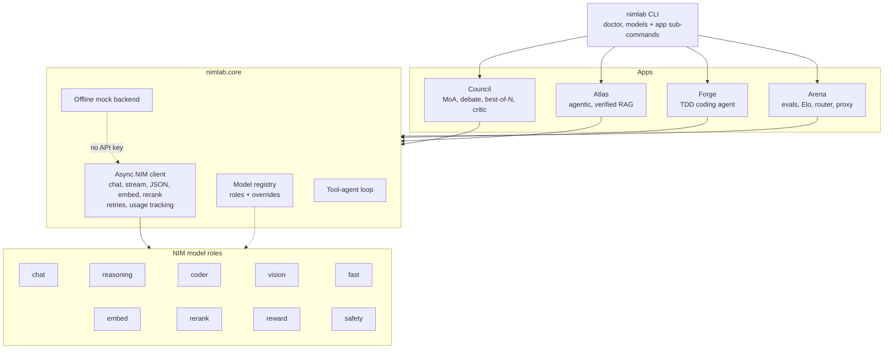

# NIM Lab

**Four applications built on NVIDIA NIM, sharing one async core.** NIM Lab is a Python monorepo that
shows what you can build when many open models are one API call away: a multi-model *council* that
deliberates, a citation-verified *RAG* engine, an autonomous test-driven *coding agent*, and an *arena*
that benchmarks models, ranks them with Elo and routes prompts to the best one. Everything runs
offline in a deterministic mock mode, so you can try it with no API key.

[](https://github.com/BumblebeeL300/Test-claude/actions/workflows/ci.yml)


## Architecture



## What's inside

| App | What it does | CLI | Docs |
| --- | --- | --- | --- |
| **Core** (`nimlab.core`) | Async NVIDIA NIM client (chat, streaming, `chat_json`, embeddings, rerank, retries, usage tracking), model registry with roles, tool-agent loop, offline mock mode | `nimlab doctor`, `nimlab models` | [docs/core.md](docs/core.md) |
| **Council** | Multi-model deliberation: mixture-of-agents, debate, best-of-N with a reward model, critic loop. Self-contained HTML trace reports | `nimlab council` | [docs/council.md](docs/council.md) |
| **Atlas** | Agentic RAG with citation checks: hybrid BM25 + dense retrieval (RRF), reranking, MMR, HyDE, multi-hop, claim verification, NemoGuard. FastAPI server and web UI | `nimlab atlas` | [docs/atlas.md](docs/atlas.md) |
| **Forge** | Autonomous TDD coding agent: plan, implement, test and debug, review, in a sandboxed workspace | `nimlab forge` | [docs/forge.md](docs/forge.md) |
| **Arena** | Eval suites and graders, time-to-first-token, Bradley-Terry Elo, HTML leaderboard, a smart router and an OpenAI-compatible routing proxy | `nimlab arena` | [docs/arena.md](docs/arena.md) |
| **Studio** | Desktop app for all four apps: native window, run streaming, project browser, Keychain key storage, macOS packaging | `nimlab studio` | [docs/studio.md](docs/studio.md) |

## Quickstart

```bash
git clone https://github.com/BumblebeeL300/Test-claude.git
cd Test-claude
pip install -e '.[dev]'          # Python 3.10+
```

**Optional: use real models.** Get a free API key at [build.nvidia.com](https://build.nvidia.com),
then put it in a git-ignored `.env`:

```bash
cp .env.example .env
# edit .env:  NVIDIA_API_KEY=nvapi-...
```

**No key? No problem.** Without `NVIDIA_API_KEY` (or with `NIMLAB_MOCK=1` / `--mock`) everything runs on an
offline, deterministic mock backend. Model text is synthetic there, but retrieval, grading, Elo, routing
and the sandbox are real computations, so you can explore every feature.

```bash
nimlab doctor                    # config, key status, mock mode, connectivity
nimlab models                    # the curated model catalog (add --live to query your endpoint)
```

One example per app:

```bash
# Council: ask several models at once and save an HTML trace
nimlab council strategies
nimlab council ask "Is a monorepo right for a small team?" -s moa --html-out council.html

# Atlas: ingest a folder, then ask a cited question and evaluate retrieval
nimlab atlas ingest examples/atlas_corpus --db atlas.db
nimlab atlas ask "What is the API rate limit?" --db atlas.db --mode agentic --verify
nimlab atlas eval examples/atlas/qa.json --db atlas.db
nimlab atlas serve --db atlas.db            # web UI + HTTP API on http://127.0.0.1:8765

# Forge: let the agent build something in a scratch directory
cp -r examples/forge/starter_workspace /tmp/forge-demo
nimlab forge run -f examples/forge/lru_cache.md -w /tmp/forge-demo --max-iters 4
nimlab forge inspect /tmp/forge-demo

# Arena: benchmark, rank and route
nimlab arena suites
nimlab arena run --suite math_reasoning --models meta/llama-3.3-70b-instruct,deepseek-ai/deepseek-r1
nimlab arena report --html-out leaderboard.html
nimlab arena route "write a python function"
nimlab arena serve                          # OpenAI-compatible proxy on http://127.0.0.1:8000, model "nimlab/auto"
```

Runtime data (`.nimlab/`, `.forge/`, `*.db`) is git-ignored. Python examples live in
[`examples/`](examples/).

## NIM Lab Studio (macOS app)

A synth-rack desktop UI for all four apps in one window: **Foundry** (type a prompt, watch Forge plan,
build, test and ship a project), **Council** (a round table of models reaching a verdict), **Atlas**
(ask your documents, with citations) and **Arena** (scoreboard and smart router), wired together by a
**Switchboard**. It is a small FastAPI server on `127.0.0.1` (token-protected) plus a static web UI shown
in a native window.

```bash
pip install -e '.[desktop]'     # optional: native window (pywebview) and Keychain (keyring)
nimlab studio                   # native window; falls back to your browser
nimlab studio --browser         # always the browser
```


| | |
| --- | --- |
|  |  |

* **No key needed to try it.** Without a key Studio shows a **SIMULATION** badge and plays scripted
  sessions: Foundry derives a small project from your prompt (real files, real `pytest`, one failing test,
  a fix), Council and Atlas compose plausible text. With a key the badge reads **LIVE** plus the masked key.
* **Key storage.** Paste your NVIDIA key in the first-run "Ignition" screen or in Settings. On macOS it is
  stored in the Keychain (elsewhere a 0600 file); it is never written to the project or the UI.
* **Build the `.app`:** run [`packaging/macos/build_app.sh`](packaging/macos/README.md) on a Mac
  (PyInstaller, ad-hoc signed, optional `.dmg`).

> **Honest status:** the `.app` build and the native pywebview window have **not been tested on a real
> Mac yet**. The server, the web UI (driven end to end with Playwright in a browser) and the PyInstaller
> spec were exercised on Linux. See [docs/studio.md](docs/studio.md) for the architecture and API.

## Model roles and overrides

Every app asks the registry for a model by *role*, never by hard-coded id.

| Role | Default | Used for |
| --- | --- | --- |
| `chat` | `meta/llama-3.3-70b-instruct` | general answers, aggregation, review |
| `reasoning` | `deepseek-ai/deepseek-r1` | planning, debate judging, math |
| `coder` | `qwen/qwen2.5-coder-32b-instruct` | writing code and tests |
| `vision` | `meta/llama-3.2-90b-vision-instruct` | image prompts |
| `fast` | `meta/llama-3.1-8b-instruct` | cheap sub-tasks |
| `embed` | `nvidia/llama-3.2-nv-embedqa-1b-v2` | retrieval, consensus, routing |
| `rerank` | `nvidia/llama-3.2-nv-rerankqa-1b-v2` | passage reranking |
| `reward` | `nvidia/llama-3.1-nemotron-70b-reward` | best-of-N scoring |
| `safety` | `nvidia/llama-3.1-nemoguard-8b-content-safety` | guardrails |

Override precedence, highest first: a command-line flag (for example `--coder`), the environment variable
`NIMLAB_MODEL_<ROLE>`, the `[models]` table of `nimlab.toml` (or the file named by `NIMLAB_CONFIG`), then the
built-in default.

```bash
export NIMLAB_MODEL_CODER=qwen/qwen3-coder-480b-a35b-instruct
```

```toml
# nimlab.toml
[models]
coder = "qwen/qwen3-coder-480b-a35b-instruct"
chat  = "meta/llama-3.1-405b-instruct"
```

Other settings (`NIM_BASE_URL`, `NIM_TIMEOUT`, `NIM_MAX_RETRIES`, `NIM_MAX_CONCURRENCY`, `NIMLAB_MOCK`, ...) are
documented in [`.env.example`](.env.example) and [docs/core.md](docs/core.md).

## Project layout

```
src/nimlab/
  cli.py          root CLI: doctor, models, auto-mounts the app CLIs
  core/           NIM client, config, registry, mock backend, tool loop, utilities
  council/        deliberation strategies, consensus, trace + HTML report
  atlas/          ingest, hybrid retrieval, agent, verification, guard, FastAPI server + UI
  forge/          planner/coder/reviewer pipeline, sandbox, patching, pytest parsing
  arena/          suites, graders, runner, Elo, leaderboard, router, proxy
tests/            offline test suite (conftest.py isolates env and global state per test)
  live/           opt-in smoke tests against the real NIM API
docs/             one guide per app plus the core
examples/         sample corpus, QA set, Forge tasks, quickstart scripts
.github/workflows/ci.yml
```

## Development

```bash
pip install -e '.[dev]'
pytest -q                # about 1,460 offline tests, no network and no key needed
ruff check .
ruff format --check .
mypy src
```

Opt-in live smoke tests (one chat, one embed, one rerank call; they spend a few free credits):

```bash
NVIDIA_API_KEY=nvapi-... NIMLAB_LIVE=1 pytest tests/live -m live -v
```

CI runs ruff, mypy and the test suite on Python 3.10 to 3.13 with `NIMLAB_MOCK=1`.

## Documentation

- [Core](docs/core.md): client, config, registry, tool loop, mock mode
- [Council](docs/council.md): strategies, traces, API
- [Atlas](docs/atlas.md): ingestion, retrieval pipeline, verification, server
- [Forge](docs/forge.md): pipeline, sandbox, reports
- [Arena](docs/arena.md): suites, graders, Elo, router, proxy

## Status

Early (0.1.0). Be aware of what has and has not been verified:

- **Verified offline only.** The code has been exercised in mock mode and against HTTP-mocked tests. Live
  NIM calls have **not** been exercised yet; this was built in an environment without an API key or access
  to the NVIDIA endpoints. Expect to fix small things on first contact with the real API.
- **Check the model catalog.** Model ids are curated from the public catalog and may not match what your
  key can use. Run `nimlab models --live` to see which are served and override roles as needed.
- **The Forge sandbox is a guard rail, not an isolation boundary.** It confines paths, scrubs the
  environment and allowlists commands, but code the agent writes still runs on your machine. Use a
  container or VM for untrusted tasks or models.
- **Mock output is synthetic.** Leaderboards and routing produced in mock mode are simulations.
- **License:** no license has been chosen yet, so no rights are granted until the owner adds one.
