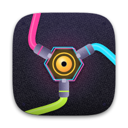
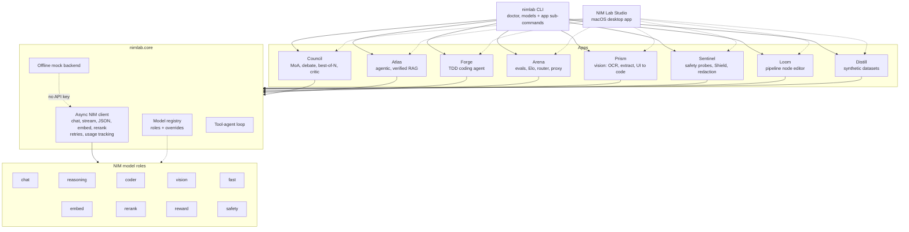
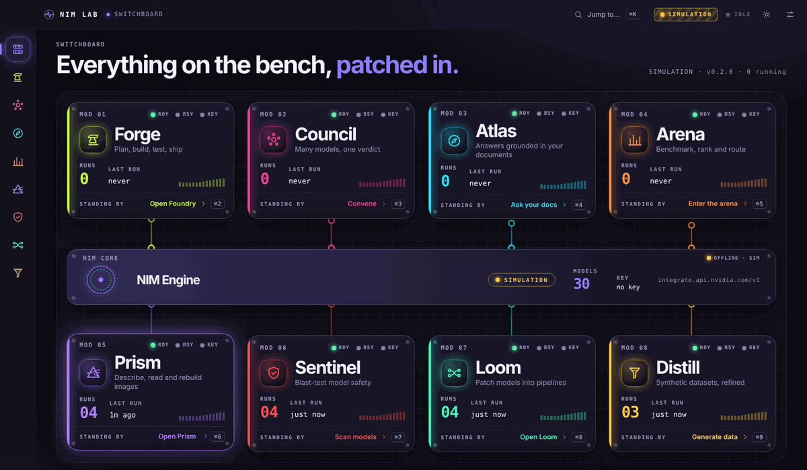
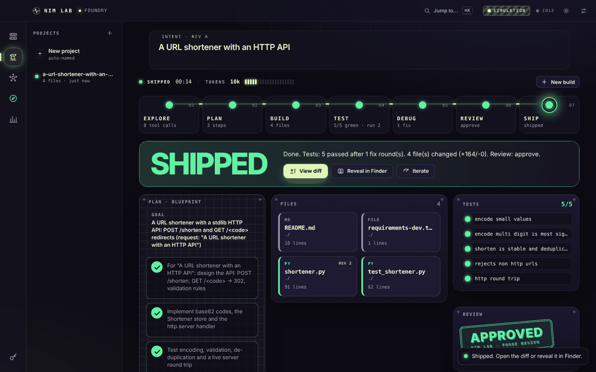
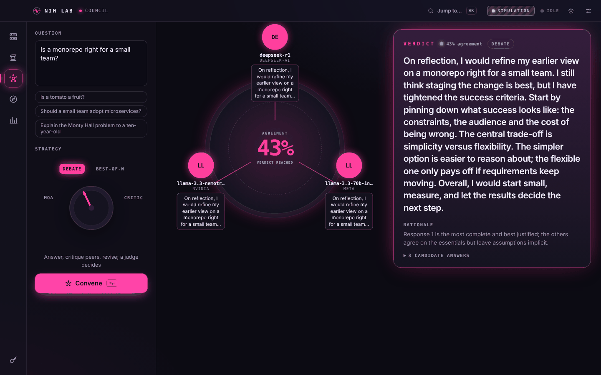

#  NIM Lab

**Eight applications built on NVIDIA NIM, sharing one async core.** NIM Lab is a Python monorepo that
shows what you can build when many open models are one API call away: a multi-model *council* that
deliberates, a citation-verified *RAG* engine, an autonomous test-driven *coding agent*, an *arena*
that benchmarks models and routes prompts to the best one, a *vision* workbench (Prism), a *safety lab*
(Sentinel), a *pipeline node editor* (Loom) and a *synthetic-dataset* refinery (Distill). Everything runs
offline in a deterministic mock mode, so you can try it with no API key.

[](https://github.com/BumblebeeL300/Test-claude/actions/workflows/ci.yml)


## Architecture



## What's inside

| App | What it does | CLI | Docs |
| --- | --- | --- | --- |
| **Core** (`nimlab.core`) | Async NVIDIA NIM client (chat, streaming, `chat_json`, embeddings, rerank, retries, usage tracking), model registry with roles, tool-agent loop, offline mock mode | `nimlab doctor`, `nimlab models` | [docs/core.md](docs/core.md) |
| **Council** | Multi-model deliberation: mixture-of-agents, debate, best-of-N with a reward model, critic loop. Self-contained HTML trace reports | `nimlab council` | [docs/council.md](docs/council.md) |
| **Atlas** | Agentic RAG with citation checks: hybrid BM25 + dense retrieval (RRF), reranking, MMR, HyDE, multi-hop, claim verification, NemoGuard. FastAPI server and web UI | `nimlab atlas` | [docs/atlas.md](docs/atlas.md) |
| **Forge** | Autonomous TDD coding agent: plan, implement, test and debug, review, in a sandboxed workspace | `nimlab forge` | [docs/forge.md](docs/forge.md) |
| **Arena** | Eval suites and graders, time-to-first-token, Bradley-Terry Elo, HTML leaderboard, a smart router and an OpenAI-compatible routing proxy | `nimlab arena` | [docs/arena.md](docs/arena.md) |
| **Prism** | Vision workbench: describe, OCR, structured extraction (built-in or custom JSON Schema), screenshot to HTML/CSS with critique-and-refine, image diff, chart to data, batch runs | `nimlab prism` | [docs/prism.md](docs/prism.md) |
| **Sentinel** | Safety lab: 64 probes across injection, jailbreak, extraction, PII, harmful, citation and over-refusal suites, scorecards and HTML reports, a Shield wrapper (NemoGuard plus heuristics) and reversible PII redaction | `nimlab sentinel` | [docs/sentinel.md](docs/sentinel.md) |
| **Loom** | Pipeline node editor: typed JSON pipelines (prompt, JSON, embed, rerank, branch, map, merge, regex, chunk, ...), parallel scheduling, caching, linting, mermaid and standalone-Python export, four bundled pipelines | `nimlab loom` | [docs/loom.md](docs/loom.md) |
| **Distill** | Synthetic datasets: multi-model generation, reward scoring, filtering, near-duplicate removal, eval-set decontamination, resumable runs, JSONL export (openai-chat, alpaca, sharegpt, dpo), HTML report and dataset card | `nimlab distill` | [docs/distill.md](docs/distill.md) |
| **Studio** | Desktop app for all eight apps: native window, run streaming, project browser, Keychain key storage, macOS packaging | `nimlab studio` | [docs/studio.md](docs/studio.md) |

## Quickstart

```bash
git clone https://github.com/BumblebeeL300/Test-claude.git
cd Test-claude
pip install -e '.[dev]'          # Python 3.10+
```

**Optional: use real models.** Get a free API key at [build.nvidia.com](https://build.nvidia.com),
then put it in a git-ignored `.env`:

```bash
cp .env.example .env
# edit .env:  NVIDIA_API_KEY=nvapi-...
```

**No key? No problem.** Without `NVIDIA_API_KEY` (or with `NIMLAB_MOCK=1` / `--mock`) everything runs on an
offline, deterministic mock backend. Model text is synthetic there, but retrieval, grading, Elo, routing
and the sandbox are real computations, so you can explore every feature.

```bash
nimlab doctor                    # config, key status, mock mode, connectivity
nimlab models                    # the curated model catalog (add --live to query your endpoint)
```

One example per app:

```bash
# Council: ask several models at once and save an HTML trace
nimlab council strategies
nimlab council ask "Is a monorepo right for a small team?" -s moa --html-out council.html

# Atlas: ingest a folder, then ask a cited question and evaluate retrieval
nimlab atlas ingest examples/atlas_corpus --db atlas.db
nimlab atlas ask "What is the API rate limit?" --db atlas.db --mode agentic --verify
nimlab atlas eval examples/atlas/qa.json --db atlas.db
nimlab atlas serve --db atlas.db            # web UI + HTTP API on http://127.0.0.1:8765

# Forge: let the agent build something in a scratch directory
cp -r examples/forge/starter_workspace /tmp/forge-demo
nimlab forge run -f examples/forge/lru_cache.md -w /tmp/forge-demo --max-iters 4
nimlab forge inspect /tmp/forge-demo

# Arena: benchmark, rank and route
nimlab arena suites
nimlab arena run --suite math_reasoning --models nvidia/nemotron-3-super-120b-a12b,nvidia/nemotron-3-ultra-550b-a55b
nimlab arena report --html-out leaderboard.html
nimlab arena route "write a python function"
nimlab arena serve                          # OpenAI-compatible proxy on http://127.0.0.1:8000, model "nimlab/auto"
```

```bash
# Prism: turn a screenshot into HTML, read a chart, extract fields
nimlab prism modes
nimlab prism ui2code examples/prism/sample_ui.png -o ui.html --refine 1
nimlab prism describe examples/prism/sample_chart.png

# Sentinel: blast-test models, then screen a prompt and redact PII
nimlab sentinel suites
nimlab sentinel scan --models nvidia/nemotron-3-super-120b-a12b --suite injection,pii_leakage --html-out scorecard.html
nimlab sentinel redact examples/sentinel/pii_sample.txt

# Loom: list, lint and run a bundled pipeline, or export it as a script
nimlab loom list
nimlab loom run research-brief --set topic="solid-state batteries"
nimlab loom graph support-triage            # mermaid flowchart

# Distill: generate a small synthetic dataset and look at its quality report
nimlab distill recipes
nimlab distill run instruction_diversity --n 40 --out /tmp/distill-demo
```

Runtime data (`.nimlab/`, `.forge/`, `*.db`) is git-ignored. Python examples live in
[`examples/`](examples/).

## NIM Lab Studio (macOS app)

A synth-rack desktop UI for all eight apps in one window: **Foundry** (type a prompt, watch Forge plan,
build, test and ship a project), **Council** (a round table of models reaching a verdict), **Atlas**
(ask your documents, with citations), **Arena** (scoreboard and smart router), **Prism** (a light table
for images), **Sentinel** (a containment lab that lights up as attacks land), **Loom** (a node editor with
live patch cables) and **Distill** (a glass distillation column), wired together by a two-tier
**Switchboard** around the NIM Core. Jump anywhere with the command palette (`⌘K`) or `⌘1` to `⌘9`. It is
a small FastAPI server on `127.0.0.1` (token-protected) plus a static web UI shown in a native window.

```bash
pip install -e '.[desktop]'     # optional: native window (pywebview) and Keychain (keyring)
nimlab studio                   # native window; falls back to your browser
nimlab studio --browser         # always the browser
```



| | |
| --- | --- |
|  |  |

* **No key needed to try it.** Without a key Studio shows a **SIMULATION** badge and plays scripted
  sessions: Foundry derives a small project from your prompt (real files, real `pytest`, one failing test,
  a fix), Council and Atlas compose plausible text. With a key the badge reads **LIVE** plus the masked key.
* **Key storage.** Paste your NVIDIA key in the first-run "Ignition" screen or in Settings. On macOS it is
  stored in the Keychain (elsewhere a 0600 file); it is never written to the project or the UI.
* **Build the `.app`:** run [`packaging/macos/build_app.sh`](packaging/macos/README.md) on a Mac
  (PyInstaller, ad-hoc signed, optional `.dmg`).

> **Honest status:** the `.app` build and the native pywebview window have **not been tested on a real
> Mac yet**. The server, the web UI (driven end to end with Playwright in a browser) and the PyInstaller
> spec were exercised on Linux. See [docs/studio.md](docs/studio.md) for the architecture and API.

## Model roles and overrides

Every app asks the registry for a model by *role*, never by hard-coded id. The table lists the preferred
default of each role as refreshed on 2026-11-03 against `integrate.api.nvidia.com/v1/models` and
build.nvidia.com (see the comments in `src/nimlab/core/registry.py` for the source of every id):

| Role | Preferred default | Used for |
| --- | --- | --- |
| `chat` | `nvidia/nemotron-3-super-120b-a12b` | general answers, aggregation, review |
| `reasoning` | `nvidia/nemotron-3-ultra-550b-a55b` | planning, debate judging, math |
| `coder` | `poolside/laguna-xs-2.1` | writing code and tests |
| `vision` | `nvidia/nemotron-3-nano-omni-30b-a3b-reasoning` | image prompts |
| `fast` | `nvidia/nemotron-3.5-lightning-30b-a3b` | cheap sub-tasks |
| `embed` | `nvidia/nemotron-3.5-embed-1b` | retrieval, consensus, routing |
| `rerank` | `nvidia/nemotron-3.5-rerank-8b` | passage reranking |
| `reward` | `nvidia/nemotron-4-340b-reward` (deprecated by NVIDIA; the judge takes over if it goes) | best-of-N scoring |
| `safety` | `nvidia/nemotron-3.5-content-safety` | guardrails |

NVIDIA retires hosted models every few weeks (and keeps some retired ids in `/v1/models`), so the defaults
are *preferences*, not promises. With a key, NIM Lab lists your endpoint's models once (cached for 24 h in
`~/NIMLab/models_cache.json`), uses the first preferred default that is actually served, falls back to the
best name match for the role (`embed`, `rerank`, `reward`, `guard`/`safety`, `vision`/`vl`, `coder`,
`r1`/`reasoning`/`thinking`, `instruct`, with the size parsed from the name), and, if a call still answers
404 / "model not found", marks that model unavailable for the session and retries once with the next
candidate (with a warning naming both models).

`nimlab models --live` shows each role's chosen model and where it came from, flags curated ids missing
from the live catalog and suggests replacements; `nimlab models --refresh` refetches the list.

Selection precedence, highest first:

1. a per-request override (a run's `model_overrides`), then the app's own override (Studio patch bay),
2. the global per-role override from Studio *Settings > Models*,
3. the environment variable `NIMLAB_MODEL_<ROLE>`, then the `[models]` table of `nimlab.toml`,
4. the first preferred default your endpoint serves, then the best heuristic match,
5. the curated default.

```bash
export NIMLAB_MODEL_CODER=poolside/laguna-xs-2.1   # pin a role from the shell
```

### Switching models inside Studio

* **Settings > Models**: one picker per role (a searchable list of your live models filtered for that role,
  "All models" to see everything, "Auto" as the default). Changes apply instantly and persist in
  `~/NIMLab/studio_settings.json`.
* **Patch bay on every app**: the plate at the top of each app shows the models that app uses (Foundry
  PLANNER / CODER / REVIEWER, Atlas EMBED / RERANK / ANSWER, Prism VISION, ...). Click a chip to pick a model
  for *that app only*; "Reset to Auto" clears it. The choice is sent with each run, and the plate shows
  "Last run via ..." including any automatic substitution.
* **`⌘K`**: "Switch model for <role>..." and "Switch <app> model...".
* Without a key the pickers show the curated catalog (the live list appears once a key is added); choices
  still persist and show up in simulated results. When the live catalog shows that a default is gone, the
  Switchboard shows an amber "N default models unavailable, auto-substituted" notice.

## Updating

* **From a git checkout** (editable install): `nimlab update` (or Studio *Settings > About > Check for
  updates*) runs `git fetch`, shows how many new commits `origin/claude/nimlab` has and, on "Update now" /
  `--yes`, runs `git pull --ff-only` and `pip install -e '.[desktop]'`, then asks you to restart. It refuses
  to touch a dirty or diverged tree and says so; offline or no git is reported, not raised.
* **Packaged `.app`**: pull the latest source and rebuild with `packaging/macos/build_app.sh`.
* **pip install**: `python -m pip install -U nimlab`.

## Uninstalling

`nimlab uninstall [--dry-run] [--keep-projects/--remove-projects] [--yes]` or Studio *Settings > Danger zone >
Uninstall NIM Lab...* (you must type `UNINSTALL`). It removes exactly the listed items: the stored API key,
settings / history / caches in `~/NIMLab` and `~/.config/nimlab`, and, only if you tick them, your Forge
projects and saved Loom pipelines, the Atlas database and the application itself (the `.app` is moved to the
Trash after the window closes; a pip install is removed with `pip uninstall` once the process has exited;
editable installs get instructions). Nothing outside those folders is ever deleted and symlinks are never
followed.

## Project layout

```
src/nimlab/
  cli.py          root CLI: doctor, models, auto-mounts the app CLIs
  core/           NIM client, config, registry, mock backend, tool loop, utilities
  council/        deliberation strategies, consensus, trace + HTML report
  atlas/          ingest, hybrid retrieval, agent, verification, guard, FastAPI server + UI
  forge/          planner/coder/reviewer pipeline, sandbox, patching, pytest parsing
  arena/          suites, graders, runner, Elo, leaderboard, router, proxy
  prism/          vision modes, image loading, schemas, UI-to-code
  sentinel/       probe suites, judges, Shield, redaction, scorecards
  loom/           pipeline schema, engine, nodes, expression evaluator, export
  distill/        recipes, generation stages, filters, dedup, export
  studio/         FastAPI server, run manager, simulation, web UI (studio/web)
tests/            offline test suite (conftest.py isolates env and global state per test)
  live/           opt-in smoke tests against the real NIM API
docs/             one guide per app plus the core
examples/         sample corpus, QA set, Forge tasks, quickstart scripts
.github/workflows/ci.yml
```

## Development

```bash
pip install -e '.[dev]'
pytest -q                # about 1,460 offline tests, no network and no key needed
ruff check .
ruff format --check .
mypy src
```

Opt-in live smoke tests (one chat, one embed, one rerank call; they spend a few free credits):

```bash
NVIDIA_API_KEY=nvapi-... NIMLAB_LIVE=1 pytest tests/live -m live -v
```

CI runs ruff, mypy and the test suite on Python 3.10 to 3.13 with `NIMLAB_MOCK=1`.

## Documentation

- [Core](docs/core.md): client, config, registry, tool loop, mock mode
- [Council](docs/council.md): strategies, traces, API
- [Atlas](docs/atlas.md): ingestion, retrieval pipeline, verification, server
- [Forge](docs/forge.md): pipeline, sandbox, reports
- [Arena](docs/arena.md): suites, graders, Elo, router, proxy
- [Prism](docs/prism.md): vision modes, schemas, UI-to-code, API
- [Sentinel](docs/sentinel.md): suites, judges, Shield, redaction, scorecards
- [Loom](docs/loom.md): pipelines, nodes, expressions, export
- [Distill](docs/distill.md): recipes, stages, export formats
- [Studio](docs/studio.md): architecture and API
- [CHANGELOG](CHANGELOG.md)

## Status

Early (0.2.1). Be aware of what has and has not been verified:

- **Verified offline only.** The code has been exercised in mock mode and against HTTP-mocked tests. Live
  NIM calls have **not** been exercised yet; this was built in an environment without an API key or access
  to the NVIDIA endpoints. Expect to fix small things on first contact with the real API.
- **Check the model catalog.** The curated ids were refreshed on 2026-11-03 from NVIDIA's public pages and
  `/v1/models` listing, but never called with a key from the environment they were written in. Live
  discovery and the 404 fallback keep things working as NVIDIA's catalog changes; run
  `nimlab models --live` on your machine to see what your key can use.
- **The Forge sandbox is a guard rail, not an isolation boundary.** It confines paths, scrubs the
  environment and allowlists commands, but code the agent writes still runs on your machine. Use a
  container or VM for untrusted tasks or models.
- **Sentinel judges are heuristic.** Refusal, citation and injection verdicts are rules (optionally an LLM
  judge), so expect some misjudged replies; the probes are a regression battery, not a full red team.
- **Mock output is synthetic.** Leaderboards and routing produced in mock mode are simulations.
- **License:** no license has been chosen yet, so no rights are granted until the owner adds one.
