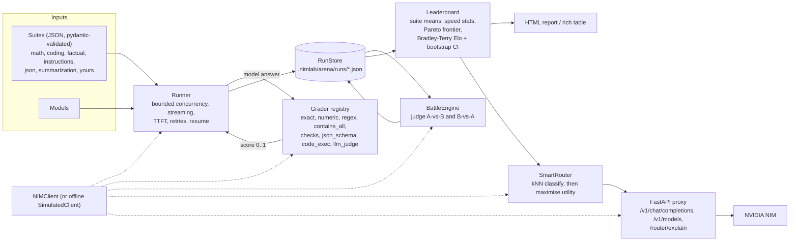

# Arena: benchmark NIM models, rank them with Elo, and route prompts to the best one

Arena answers three questions about the models behind NVIDIA NIM:

1. **How good is each model on the tasks I care about?** Six bundled, original eval suites (plus your own JSON suites) are run against any set of models, concurrently, with per-item latency, **time-to-first-token (TTFT)** and tokens/s.
2. **Which model is better head to head?** An LLM judge compares answers pairwise (each pair judged **twice with the positions swapped**); a **Bradley-Terry** fit turns the outcomes into **Elo** ratings with **bootstrap confidence intervals**.
3. **Which model should serve this prompt?** A **SmartRouter** classifies the prompt (embedding kNN, keyword fallback, optional LLM) and picks the model maximising `quality - latency penalty - cost penalty` from the latest leaderboard data. An **OpenAI-compatible proxy** exposes that as `model: "nimlab/auto"`.

Everything runs **fully offline** in mock mode (`NIMLAB_MOCK=1`, `--mock`, or automatically when `NVIDIA_API_KEY` is unset); see [Mock mode](#mock-mode-the-offline-simulator).

```bash
nimlab --mock arena run --models nvidia/nemotron-3-super-120b-a12b,nvidia/nemotron-3-ultra-550b-a55b --concurrency 8
nimlab --mock arena report --html-out leaderboard.html
nimlab --mock arena route "Write a function that merges overlapping intervals"
nimlab --mock arena serve --port 8000     # then point any OpenAI client at http://127.0.0.1:8000/v1
```

## Architecture



| Module | Responsibility |
|---|---|
| `nimlab.arena.suites` | `Suite` / `EvalItem` / `GraderSpec` pydantic models, loading, resolution (`all`, names, file paths) |
| `src/nimlab/arena/suites/*.json` | the six bundled suites |
| `nimlab.arena.graders` | pluggable grader registry; sandboxed `code_exec`; dependency-free JSON Schema validator |
| `nimlab.arena.runner` | `Runner`: models x suites x items, bounded concurrency, streaming TTFT, retries, checkpointing, resume |
| `nimlab.arena.results` | `ItemResult`, `RunResult`, `BattleRecord`, `RunStore` (atomic JSON persistence) |
| `nimlab.arena.battle` | `BattleEngine`: position-swapped pairwise LLM judging |
| `nimlab.arena.elo` | numpy Bradley-Terry (MM) fit, Elo scale, bootstrap CIs |
| `nimlab.arena.leaderboard` | `Leaderboard.from_run`: rankings, per-suite scores, Pareto frontier, Elo |
| `nimlab.arena.report` | self-contained HTML (jinja2, inline CSS/SVG) and rich terminal tables |
| `nimlab.arena.router` | `SmartRouter`: classification + utility-based selection + explanations |
| `nimlab.arena.proxy` | `create_app()`: OpenAI-compatible FastAPI proxy |
| `nimlab.arena.simulate` | offline `SimulatedClient` that makes mock-mode results meaningful |
| `nimlab.arena.arena` | `Arena` facade tying it together |
| `nimlab.arena.cli` | Typer app mounted as `nimlab arena ...` |

## Eval suites

A suite is a JSON file validated by pydantic (`nimlab.arena.suites.Suite`). Unknown keys, duplicate item ids, unknown grader types, invalid regexes, uncompilable hidden tests and unknown categories are rejected at load time with a precise message.

```json
{
  "name": "support_triage",
  "description": "Classify support tickets.",
  "category": "instruction_following",
  "system": "Answer with exactly one lowercase label.",
  "temperature": 0.0,
  "max_tokens": 20,
  "grader": { "type": "exact", "expected": "billing" },
  "items": [
    { "id": "double-charge", "prompt": "Ticket: \"Charged twice this month.\" ...", "reference": "billing" },
    { "id": "crash", "prompt": "...", "grader": { "type": "exact", "expected": "bug" } }
  ]
}
```

* `category` is what the router uses to attribute the suite's scores to a task type: one of `math_reasoning`, `coding`, `factual_qa`, `instruction_following`, `json_compliance`, `summarization`, `general_chat`.
* `grader` is the suite default; each item may override it. The grader object is flat: `type` plus that grader's parameters.
* `reference` is an optional gold answer. It is shown to judges (`llm_judge`, battles) and is what the offline simulator replays; for deterministic suites every bundled reference passes its own grader (this is tested).
* `open_ended: true` plus `battle_rubric` marks suites that make sense for pairwise battles.
* `weight` (per item) lets some items count more in the suite mean.

`examples/arena/custom_suite.json` is a small working example. Use it with `nimlab arena run --suite examples/arena/custom_suite.json` or drop a directory of files and pass `--suites-dir DIR`.

### Bundled suites

| Suite | Items | Grader(s) | What it checks |
|---|---|---|---|
| `math_reasoning` | 12 | `numeric` | word problems with one numeric answer |
| `coding` | 12 | `code_exec` | write a Python function/class; hidden unit tests run in a sandbox |
| `factual_qa` | 12 | `exact`, `regex`, `contains_all` | short, well-established facts |
| `instruction_following` | 12 | `checks` | word counts, ALL CAPS, bullet counts, required/forbidden words, ordering |
| `json_compliance` | 10 | `json_schema` | reply must contain JSON matching a schema (some in strict mode) |
| `summarization` | 10 | `llm_judge` | faithful, covering, concise summaries (also used for battles) |

All items are original. List them with `nimlab arena suites` and inspect one with `nimlab arena suites --show coding`.

### Graders

Graders are registered by name (`register_grader`); hyphens and a few aliases (`numeric-tolerance`, `programmatic-checks`, `contains-all`) are accepted. Every grader returns `GradeResult(score in [0,1], passed, detail, ...)`.

| Type | Parameters | Score |
|---|---|---|
| `exact` | `expected` (str or list), `case_sensitive`, `mode: equals\|contains` | 1 if the normalised output equals (or contains as a whole word) an accepted answer. Normalisation drops markdown emphasis, "Answer:" lead-ins, quotes and edge punctuation. |
| `numeric` | `expected`, `rel_tol`, `abs_tol`, `extract: auto\|first\|last` | 1 if the final number is within tolerance. `auto` prefers `\boxed{}`, then the last `Answer: ...` line, then the last number; handles `1,234.5`, `$12`, `3/4`, `1e3`, unicode minus. |
| `regex` | `pattern`, `flags` (`imsx`), `mode`, `negate` | 1 on match |
| `contains_all` | `required`, `forbidden`, `any_of` (groups), `case_sensitive`, `whole_word` | fraction of satisfied conditions; `passed` needs all |
| `checks` | `checks: [{type, ...}]` | fraction of passed checks. Types: `word_count`, `char_count`, `sentence_count`, `paragraph_count`, `line_count`, `bullet_count`, `numbered_list` (all take `exactly` / `min` / `max`), `only_bullets`, `all_caps`, `all_lowercase`, `includes`, `excludes`, `starts_with`, `ends_with`, `regex`, `no_commas`, `in_order`, `max_words_per_paragraph`, `json_parses` |
| `json_schema` | `schema`, `strict` | 1 if the output's JSON validates. `strict` forbids prose around the JSON (a single code fence is tolerated). Uses a built-in validator for the common draft 2020-12 subset (`type`, `enum`, `const`, `properties`/`required`/`additionalProperties`, `items`/`prefixItems`, size and range keywords, `pattern`, `format` date/date-time/email, `allOf`/`anyOf`/`oneOf`/`not`, local `$ref`); its verdicts are cross-checked against the reference `jsonschema` library in the test-suite. |
| `code_exec` | `tests` (list of Python snippets), `entrypoint`, `timeout_s`, `test_timeout_s`, `memory_mb` | fraction of hidden tests that pass |
| `llm_judge` | `rubric`, `pass_threshold`, `use_reference`, `judge_model` | the judge returns an integer 1-10 and a rationale through `chat_json`; score = `(s - 1) / 9` |

Writing your own:

```python
from pydantic import BaseModel
from nimlab.arena import GradeContext, Grader, GradeResult, register_grader

class StartsWithParams(BaseModel):
    prefix: str

@register_grader
class StartsWithGrader(Grader):
    name = "starts_with"
    Params = StartsWithParams

    async def run(self, params: StartsWithParams, ctx: GradeContext) -> GradeResult:
        ok = ctx.output.startswith(params.prefix)
        return GradeResult(score=float(ok), passed=ok, detail=f"prefix {params.prefix!r}")
```

If a grader raises `GraderError` (for example the judge model is unreachable) the item is recorded as *errored* and excluded from the score rather than counted as a wrong answer.

### The code-execution sandbox

`code_exec` extracts the model's Python (last fenced block containing the entrypoint, else the last Python block, else the raw text), then runs it plus the hidden tests in a **separate interpreter**:

* isolated mode (`python -I -B`), a throw-away temp directory as cwd, deleted afterwards;
* a **scrubbed environment**: only `PATH`, `LANG`, `HOME`/`TMPDIR` (the temp dir) and two Python settings, so `NVIDIA_API_KEY`, cloud credentials and everything else in your shell are invisible;
* POSIX resource limits (CPU seconds, address space, file size, open files, no core dumps);
* sockets are disabled inside the interpreter (no network);
* a **per-test alarm** (`test_timeout_s`) so one infinite loop costs one test, and a **wall-clock timeout** (`timeout_s`) after which the whole process group is killed;
* stdout/stderr go to size-limited files, and the verdict travels over a nonce-tagged line so the solution cannot forge a result by printing.

This is a best-effort guard for grading model output on your own machine, not a security boundary against a determined attacker; run Arena inside a container if you grade untrusted code at scale.

## Running benchmarks

For every `(model, suite, item)` the runner

1. builds `[system, user]` messages from the suite and calls `client.stream_chat(...)`, recording the **time to first non-empty chunk** (TTFT), the total latency and the output;
2. strips `<think>` blocks, then grades the answer;
3. retries **transient** failures (rate limits, timeouts, 5xx, dropped connections; never auth errors or 4xx) with exponential backoff and jitter, up to `max_retries` times;
4. appends an `ItemResult` and checkpoints the run to `.nimlab/arena/runs/<timestamp>.json` (atomic write: temp file + rename).

Concurrency is bounded by a semaphore (`--concurrency`, optionally also per model). An authentication error aborts the run (after saving what finished); any other failure is recorded on the item and the run continues with `status: "partial"`.

**Resume**: `nimlab arena run --resume <run id>` (or `Arena.run(resume=...)`) re-queries only items that are missing, errored, or whose definition (prompt, system prompt, grader, limits) changed since the stored result, and adds new models to an existing run. Item fingerprints make resuming safe after editing a suite.

Measurements stored per item: `latency_s`, `ttft_s`, `tokens_in`, `tokens_out`, `tokens_per_s` (decode-phase: `tokens_out / max(latency - ttft, 0.1 * latency)`), the raw `output`, `score`, `passed`, the grader's `detail` and the number of `attempts`. Token counts for streamed calls are estimated (about 4 characters per token) because the streaming API does not return usage; `usage_estimated` says so. If streaming is unavailable the runner falls back to `chat()` (no TTFT, API-reported usage).

### How scores are computed

* **Item score** `s` in `[0, 1]`, from the item's grader.
* **Suite score** of a model: `sum(w_i * s_i) / sum(w_i)` over its *scored* items (errored items are excluded and counted separately).
* **Overall score**: the unweighted mean of the model's suite scores (every suite counts equally, regardless of its size).
* **Speed**: medians over scored items (latency p50/p95, TTFT p50, tokens/s).
* **Cost tier** comes from the model registry (`ModelInfo.cost_tier`, 1 cheapest to 5 largest).
* **Pareto frontier**: a model is on the frontier when no other model is both at least as fast (median latency) and at least as good (overall), and strictly better in one.

## Pairwise battles and Elo

For open-ended items a point score is a poor yardstick, so Arena also compares models head to head.

**Judging.** For a pair of models `(a, b)` and an item, the judge sees the task, the criteria (`battle_rubric`), optionally the reference, and the two answers as "Answer A" and "Answer B", and returns `A`, `B` or `tie` with a rationale (`chat_json`, schema `PairwiseVerdict`). The comparison is run **twice with the slots swapped** (`a` first, then `b` first). Each verdict scores `1` / `0.5` / `0` for `a`, and the battle's score is the mean of the two:

```
score_a = (v1 + v2) / 2        in {1, 0.75, 0.5, 0.25, 0}
```

A judge that always prefers slot A produces `v1 = 1, v2 = 0`, so `score_a = 0.5`: position bias cancels instead of becoming signal. The share of decisive verdicts that picked slot A is reported (`50%` means no position bias). Judges tend to favour their own answers, so the CLI warns when the judge is also a contestant.

**Bradley-Terry.** Each model gets a positive strength `p_i` with `P(i beats j) = p_i / (p_i + p_j)`. With `W_ij` the points `i` scored against `j` (wins 1, ties 1/2, fractional battle scores allowed) and `N_ij = W_ij + W_ji` the games played, the maximum-likelihood strengths are the fixed point of the minorise-maximise update (Hunter 2004):

```
p_i  <-  W_i / sum_j [ N_ij / (p_i + p_j) ]        W_i = sum_j W_ij
```

followed by a rescale to unit geometric mean at every step. A *virtual opponent* of average strength that ties one game with everybody keeps ratings finite for a model that never lost (a weak ridge-style prior). Ratings are reported on the Elo scale:

```
elo_i = 1000 + 400 * log10(p_i)          (mean rating 1000; 400 points = 10:1 odds)
```

**Confidence intervals.** The games are resampled with replacement (`--bootstrap`, default 200), the model is refit each time (warm-started), and the central 95% percentile interval of each rating is reported. More games, tighter bars; the HTML report draws them as error bars.

**Elo without a judge.** If a run has no battles, the leaderboard derives games from the graded scores: for every item, every pair of models that both answered plays one game (higher score wins, scores within 0.05 tie). The report states which source was used.

```bash
nimlab arena battle --models nvidia/nemotron-3-ultra-550b-a55b,nvidia/nemotron-3.5-lightning-30b-a3b,deepseek-ai/deepseek-v4.1-flash \
    --suite summarization --judge-model nvidia/nemotron-3-super-120b-a12b
```

## Reports

`nimlab arena report [RUN] --html-out leaderboard.html` renders a **self-contained** page (jinja2 template, inline CSS, inline SVG, one small inline script for tooltips; no external assets, fonts or network requests). It follows the OS light/dark setting (`prefers-color-scheme`, plus a `data-theme` override), is readable at phone width (tables and charts scroll inside their card, the page never scrolls sideways) and contains:

* highlights (top model, fastest, best score at the lowest cost tier, Pareto count);
* **overall ranking** table: overall score bar, Elo with CI, latency p50, TTFT p50, tokens/s, cost tier, errors;
* **per-suite score heatmap** (one-hue sequential ramp; the best model per suite is underlined);
* **Elo chart** with 95% CI error bars (SVG);
* **quality vs latency scatter** (SVG, log latency axis when the range is wide) with the **Pareto frontier** highlighted and connected.

The same data prints as a rich table in the terminal. Runs produced in mock mode carry a "Simulated data" banner. Model names are HTML-escaped.

## Smart routing

```python
from nimlab.arena import SmartRouter

router = SmartRouter()                       # uses the latest runs in .nimlab/arena/runs
decision = router.route_sync("Prove that the square root of 2 is irrational")
print(decision.model, decision.category)
print(decision.explain())
```

`await router.route(prompt_or_messages)` is the async form; chat-style message lists work (the last user message is classified; a message with an image routes to the registry's vision model).

### 1. Classify the prompt

Seven categories: the six suite categories plus `general_chat`.

1. **Embedding kNN** (default). `exemplars.json` bundles 12 labelled prompts per category. They are embedded once (`input_type="passage"`, `Role.EMBED` model), the query is embedded with `input_type="query"`, and the `k = 5` most similar exemplars vote with weight `exp(sim / 0.1)`. The vote share of the winning category is the confidence. The kNN answer is accepted when `share >= 0.5` and the top similarity is `>= 0.15`.
2. **Keyword heuristics** are the fallback (low similarity, split vote, or the embedding endpoint failing; failures back off for 60 s). Weighted regex evidence per category; no match means `general_chat`.
3. **LLM classification** with the `Role.FAST` model through `chat_json` (`classifier="llm"`, or `use_llm=True` to consult it only when the kNN and keywords are both unsure; `--llm` on the CLI).

With no client the router embeds locally with the core library's hashed bag-of-words vectors, so it works offline.

### 2. Choose the model

For the classified category `c` and each candidate model `m` on the leaderboard:

```
utility(m) = quality(m, c) - lambda_latency * latency_s(m, c) - lambda_cost * cost_tier(m)
```

* `quality(m, c)` is the mean score of `m` on the suites whose `category` is `c` (for `general_chat`, or when no suite covers `c`, its overall score; the decision says which basis was used).
* `latency_s(m, c)` is the mean over those suites of `m`'s median item latency (missing data falls back to the median of the other candidates).
* `cost_tier` is the registry tier 1-5 (unknown models count as 3).

The "latest leaderboard data" is the **newest result per (model, suite, item) across the last 20 saved runs**: a model benchmarked last week on coding and yesterday on math contributes both. The router re-reads the runs directory when it changes.

| Profile | `lambda_latency` (per second) | `lambda_cost` (per tier) | Intent |
|---|---|---|---|
| `quality` | 0.002 | 0 | best answer, nearly regardless of speed or price |
| `balanced` (default) | 0.02 | 0.03 | a 10 s answer costs 0.2 quality points, a tier 0.03 |
| `speed` | 0.08 | 0.02 | prefer fast models |
| `economy` | 0.02 | 0.10 | prefer cheap models |

Override with `--latency-weight` / `--cost-weight` (CLI) or `latency_weight=` / `cost_weight=` (Python). Restrict the pool with `allow=[...]`.

**Fallback.** With no leaderboard data (or for images) the router returns the registry default for the category's role (`math_reasoning` -> `Role.REASONING`, `coding` -> `Role.CODER`, images -> `Role.VISION`, everything else -> `Role.CHAT`); `NIMLAB_MODEL_<ROLE>` overrides apply.

### Explainability

Every `RoutingDecision` carries the category, classifier, confidence, the nearest exemplars, **all candidates with the three utility terms**, and human-readable reasons:

```text
$ nimlab arena route "Write a Python function that merges overlapping intervals"
 Routing decision
 nvidia/nemotron-3-ultra-550b-a55b
 category coding via knn (confidence 86%) - source leaderboard - profile balanced
  * Classified as 'coding' by embedding kNN (vote share 86%); nearest exemplar: "Write a Python function that reverses a linked list." (similarity 0.48).
  * Using leaderboard run merged-20261101T214503Z: quality is measured on the 'coding' suite (mock/simulated data).
  * Profile 'balanced': utility = quality - 0.02 x latency(s) - 0.03 x cost_tier.
  * nvidia/nemotron-3-ultra-550b-a55b has the highest utility 0.694 (quality 0.917, latency 5.14s, cost tier 4).
  * Runner-up poolside/laguna-xs-2.1 scored 0.676 (margin 0.017).
 Candidates
  Model                              Quality  Latency  Cost  Utility
  -> nvidia/nemotron-3-ultra-550b-a55b           0.917    5.14s     4    0.694
     poolside/laguna-xs-2.1   0.771    1.71s     2    0.676
     ...
```

(Numbers above come from a simulated run.) `--json` prints the full decision.

## OpenAI-compatible routing proxy

```bash
nimlab arena serve --port 8000            # add --mock to stay offline
```

| Endpoint | Behaviour |
|---|---|
| `POST /v1/chat/completions` | OpenAI chat format, non-streaming and `stream: true` (SSE `chat.completion.chunk` events ending with `data: [DONE]`). `model: "nimlab/auto"` routes; any other model id passes through to NIM. `tools`, `tool_choice`, `response_format`, `temperature`, `max_tokens` and other sampling fields are forwarded. |
| `GET /v1/models` | OpenAI model list: `nimlab/auto` first, then the chat-capable registry models and models seen on the leaderboard. |
| `GET /router/explain?prompt=...` | the routing decision as JSON (optional `profile`, `category`) |
| `GET /router/leaderboard` | the standings the router is using |
| `GET /health` | status, mock flag, leaderboard run |

Response header **`x-nimlab-routed-model`** always names the model that served the request (also for pass-through); routed requests add `x-nimlab-category` and `x-nimlab-routing-source`, and the JSON body gets a `nimlab` object with the reasons. Choose a routing profile with `model: "nimlab/auto:speed"` (or `quality`, `economy`, `balanced`) or the request header `x-nimlab-profile`; skip classification with `x-nimlab-category: coding`. Errors use the OpenAI shape `{"error": {"message", "type", "code"}}` (401 auth, 429 with `retry-after`, 400 invalid request, 502 upstream). An upstream failure before the first streamed token is a proper HTTP error; after streaming has started it is sent in-band as an `error` event.

The proxy has no authentication of its own: it uses the server's `NVIDIA_API_KEY`. Bind it to localhost or put it behind your own gateway.

```bash
curl -s http://127.0.0.1:8000/v1/chat/completions \
  -H 'content-type: application/json' -i \
  -d '{"model": "nimlab/auto",
       "messages": [{"role": "user", "content": "Write a function that merges overlapping intervals"}]}'
# HTTP/1.1 200 OK
# x-nimlab-routed-model: poolside/laguna-xs-2.1
# x-nimlab-category: coding
# ...

curl -sN http://127.0.0.1:8000/v1/chat/completions -H 'content-type: application/json' \
  -d '{"model": "nimlab/auto:speed", "stream": true,
       "messages": [{"role": "user", "content": "Capital of Peru?"}]}'

curl -s 'http://127.0.0.1:8000/router/explain' --get --data-urlencode 'prompt=Solve 3x + 7 = 28' | python -m json.tool
```

With the official `openai` SDK (`pip install openai`):

```python
from openai import OpenAI

client = OpenAI(base_url="http://127.0.0.1:8000/v1", api_key="not-checked")

raw = client.chat.completions.with_raw_response.create(
    model="nimlab/auto",
    messages=[{"role": "user", "content": "Summarize: the city opened a new tram line ..."}],
)
print("served by:", raw.headers["x-nimlab-routed-model"])
print(raw.parse().choices[0].message.content)

for chunk in client.chat.completions.create(
    model="nimlab/auto", stream=True,
    messages=[{"role": "user", "content": "What is the capital of Peru?"}],
):
    print(chunk.choices[0].delta.content or "", end="", flush=True)
```

From Python you can also embed the app: `from nimlab.arena.proxy import create_app` and pass a client/router of your own (`create_app(client=..., router=...)`).

## CLI reference

Every command except `suites` accepts `--mock` (a root-level `nimlab --mock arena ...` works too) and `--runs-dir` (default `.nimlab/arena/runs`, or `$NIMLAB_HOME/arena/runs`, or `$NIMLAB_ARENA_RUNS`).

| Command | Purpose |
|---|---|
| `nimlab arena suites [--show NAME] [--json] [--suites-dir DIR]` | list suites (or the items of one) |
| `nimlab arena run --suite all\|a,b\|FILE --models a,b --concurrency 4 [--limit N] [--resume RUN] [--judge-model M] [--html-out F]` | benchmark and print the leaderboard |
| `nimlab arena battle --models a,b,c --suite summarization [--judge-model M] [--max-items N] [--max-pairs N] [--from-run RUN]` | pairwise battles and Elo with CIs |
| `nimlab arena report [RUN] [--html-out leaderboard.html] [--bootstrap N]` | show a saved run (`RUN` = id, path or `latest`) |
| `nimlab arena route "prompt" [--profile P] [--latency-weight X] [--cost-weight Y] [--category C] [--llm] [--json]` | explain a routing decision |
| `nimlab arena serve [--host H] [--port N]` | run the OpenAI-compatible proxy |

`--models` defaults to the registry's chat, reasoning, coder and fast models.

## Python API

```python
import asyncio
from nimlab.arena import Arena

async def main() -> None:
    async with Arena(concurrency=8) as arena:            # mock mode unless NVIDIA_API_KEY is set
        run = await arena.run(
            ["nvidia/nemotron-3-super-120b-a12b", "nvidia/nemotron-3-ultra-550b-a55b"],
            suites="all",                                # or ["coding", "factual_qa"], or Suite objects
        )
        board = arena.leaderboard(run)
        for s in board.standings:
            print(s.rank, s.model, round(s.overall, 3), s.elo, s.latency_p50_s)

        battles = await arena.battle(
            ["nvidia/nemotron-3-super-120b-a12b", "nvidia/nemotron-3-ultra-550b-a55b", "deepseek-ai/deepseek-v4.1-flash"],
            "summarization",
        )
        arena.report(battles, html_out="leaderboard.html")

        router = arena.router(profile="speed")
        decision = await router.route("Solve 3x + 7 = 28")
        print(decision.model, decision.explain())

asyncio.run(main())
```

Lower-level pieces are importable too: `Runner`, `BattleEngine`, `fit_bradley_terry`, `bootstrap_elo`, `Leaderboard`, `RunStore`, `load_suite`, `register_grader`. `Arena(client=...)` accepts any object with the `NIMClient` methods (`chat`, `stream_chat`, `chat_json`, `embed`); that is how the tests drive it with scripted fakes.

## Mock mode: the offline simulator

The core library's mock backend returns generic prose, which no grader would accept, so a benchmark on it would be a wall of zeros. In mock mode Arena therefore uses `SimulatedClient`, which recognises benchmark prompts from the loaded suites and answers like a model of a given strength would:

* each model gets a deterministic profile from the registry: larger cost tiers are more accurate but slower; coder models are strong at code, reasoning models at math (and have a long TTFT);
* whether a model answers an item correctly is a deterministic function of `(model, item)`; correct answers replay the item's `reference` (for `numeric`, `exact` and `contains_all` items without one the answer is synthesised from the grader parameters; give other items a `reference` if you want them to be answerable), wrong ones are plausible failures (a numeric slip, a stub function, malformed JSON);
* it also plays the judge (token overlap with the reference, with a mild position bias for near-ties) and the task classifier;
* delays are **virtual**: the client sleeps for `virtual_seconds * time_scale` (0.04) and advertises `time_scale`, and the runner reports the unscaled figures, so a full 4-model benchmark finishes in a few seconds yet shows realistic multi-second latencies;
* anything it does not recognise (arbitrary chat for the proxy, tool calls, other JSON schemas, embeddings) is delegated to the core mock backend.

Results are clearly labelled as simulated (terminal banner, HTML banner, `mock: true` in the run file). They demonstrate the tooling; they say nothing about real models.

## Files and state

```
src/nimlab/arena/
  suites/*.json        bundled eval suites          exemplars.json   router exemplars
  graders/             exact, numeric, regex, contains_all, checks, json_schema, code_exec, judge, sandbox
  runner.py results.py battle.py elo.py leaderboard.py report.py router.py proxy.py
  simulate.py arena.py cli.py llm.py  templates/leaderboard.html.j2
.nimlab/arena/runs/<UTC timestamp>.json     one file per run (items, battles, config)
```

Run files are plain JSON (`RunResult` in `nimlab.arena.results`) and can be diffed, archived or loaded with `RunStore(...).load(...)`.

## Testing

```bash
python -m pytest tests/arena           # fully offline
ruff check src/nimlab/arena tests/arena
```

The suite covers schema validation of every bundled suite (and that each reference answer passes its own grader), every grader including the sandbox's timeouts, environment scrubbing, network block and verdict-forgery resistance, the runner with a scripted fake client (known answers, TTFT from the stream, retries, concurrency bound, persistence, resume), Bradley-Terry recovery of a known ordering with bootstrap CIs, position-bias cancellation, the HTML report, router classification/utility/explanations, the proxy (SSE format, routed-model header, error mapping) and the CLI via `CliRunner`.

## Limitations

* Streamed token counts are estimates (the NIM streaming API does not return usage); latency, TTFT and tokens/s are measured from the client side and include network time.
* LLM judging is only as good as the judge: use a strong model that is not a contestant, and prefer battles (position-swapped) over single scores for open-ended tasks.
* The sandbox is best effort, see above.
* The router's quality estimate is only as representative as the suites: add suites for your workload (`--suites-dir`) and re-run to keep the leaderboard current.
