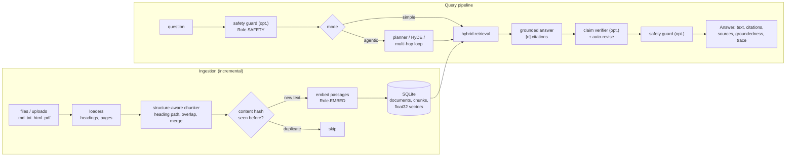
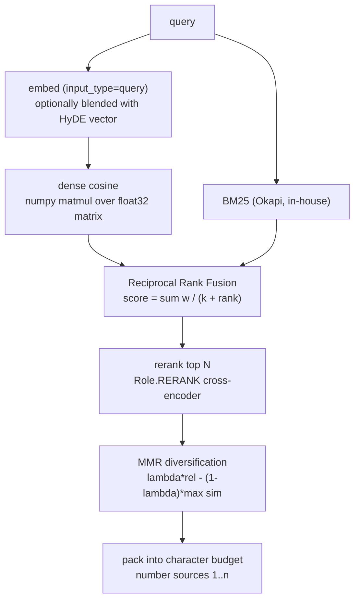

# Atlas: agentic, citation-verified RAG

Atlas answers questions from your own documents and shows its work. Every statement in an answer
carries an inline citation (`[1]`, `[2]`) that maps to a concrete chunk (file, heading path, page);
an optional verifier then checks each claim against the passages it cites and reports a
**groundedness score**; an optional safety guard screens the question and the answer.

It is one of the four NIM Lab apps, built on `nimlab.core` (async NIM client, model registry,
mock backend) and written to run **fully offline**: with no `NVIDIA_API_KEY` (or `NIMLAB_MOCK=1`)
retrieval, ranking and the groundedness check are real computations over deterministic mock
embeddings, while model text is synthetic filler.

```
nimlab --mock atlas ingest examples/atlas_corpus
nimlab --mock atlas ask "What is the API rate limit?" --verify
nimlab --mock atlas serve            # web UI on http://127.0.0.1:8765
```

## Contents

1. [Quick start](#quick-start)
2. [Architecture](#architecture)
3. [Ingestion and storage](#ingestion-and-storage)
4. [Retrieval pipeline](#retrieval-pipeline)
5. [Query modes](#query-modes)
6. [Grounded answers, citations and verification](#grounded-answers-citations-and-verification)
7. [Safety guard](#safety-guard)
8. [CLI](#cli)
9. [Python API](#python-api)
10. [HTTP API and web UI](#http-api-and-web-ui)
11. [Evaluation](#evaluation)
12. [Tuning knobs](#tuning-knobs)
13. [Mock mode](#mock-mode)
14. [Design notes and limits](#design-notes-and-limits)
15. [Tests and layout](#tests-and-layout)

## Quick start

```bash
pip install -e '.[dev]'

# 1. index the example handbook (5 markdown files) into .nimlab/atlas.db
nimlab --mock atlas ingest examples/atlas_corpus

# 2. ask, with claim verification and the pipeline trace
nimlab --mock atlas ask "How many missed heartbeats mark a robot as lost?" --verify --trace

# 3. multi-hop question, planned and searched by the agent
nimlab --mock atlas ask "What must I finish before primary on-call, and who is paged if the \
primary does not acknowledge?" --mode agentic --k 6

# 4. measure retrieval quality
nimlab --mock atlas eval examples/atlas/qa.json
```

Drop `--mock` and export `NVIDIA_API_KEY` to use live NIM models. The embedding model of a collection
is recorded in the database; mock and live vectors are never mixed (see [Mock mode](#mock-mode)).

## Architecture



### Hybrid retrieval, in detail



Failure handling is graceful: if the embedding call fails (not auth) Atlas continues with BM25 only
and records a warning; if the reranker fails the fused order is kept. Authentication errors always
surface.

## Ingestion and storage

* **Loaders** (`loaders.py`): Markdown (ATX and setext headings, YAML front matter title, fenced code
  never produces headings), plain text, HTML (stdlib `html.parser`; `script/style/nav` dropped,
  headings become sections, lists/tables/`pre` keep their shape) and PDF (`pypdf`, one section per
  page so citations carry the page number; hard-wrapped lines are re-flowed, scanned PDFs report a
  clear error).
* **Chunking** (`chunking.py`): sections are cut into paragraph blocks and packed up to
  `chunk_max_chars`. Fenced code, lists and tables stay intact when they fit (oversized code blocks are
  split with balanced fences); consecutive chunks of one section share `chunk_overlap` characters;
  chunks under `chunk_min_chars` are merged with a neighbour, restating the heading line so no context
  is lost. Every chunk keeps its **heading path** (`Guide > Setup > Install`) and **page**; the
  breadcrumb is part of the text that is embedded and BM25-indexed.
* **Dedup**: chunks are unique per collection by SHA-256 of their whitespace-normalised text.
* **Incremental re-ingest**: a file whose raw-bytes hash and chunking/embedding signature are
  unchanged is skipped without any network call. A changed file is re-chunked and only chunks whose
  text is new are embedded; the vectors of unchanged chunks are reused. `--prune` removes documents
  whose files disappeared from an ingested directory; `--force` re-ingests everything.
* **Store** (`store.py`): SQLite with `collections`, `documents` and `chunks` tables (WAL mode,
  foreign keys). Vectors are stored as little-endian float32 BLOBs, L2-normalised. A collection's
  vectors are loaded lazily into one numpy matrix (cosine == dot product) next to a BM25 index; both
  are cached and rebuilt after writes. Default path: `.nimlab/atlas.db` (`--db`, `$NIMLAB_ATLAS_DB`).
* **Collections** are namespaces: `--collection handbook`. The embedding model/dimension is pinned
  per collection; `atlas reindex` re-embeds the stored chunk text with the current model.

## Retrieval pipeline

| Stage | What happens | Knobs |
|---|---|---|
| Dense | query embedded with `input_type="query"` (+ optional HyDE blend), top-N by cosine | `candidates`, `hyde`, `hyde_weight` |
| BM25 | `idf = ln(1 + (N - n + 0.5)/(n + 0.5))`, `tf*(k1+1) / (tf + k1*(1 - b + b*dl/avgdl))`, light stemming + stop words | `bm25_k1`, `bm25_b` |
| RRF | `sum_i w_i / (rrf_k + rank_i)` across the two rankings | `rrf_k`, `dense_weight`, `bm25_weight` |
| Rerank | top `rerank_candidates` fused chunks scored by the reranker | `use_rerank`, `rerank_candidates` |
| MMR | greedy `lambda*relevance - (1-lambda)*max cosine to picked`, relevance min-max scaled | `use_mmr`, `mmr_lambda` |
| Packing | best-first within a character budget; an oversized first chunk is truncated at a sentence | `k`, `context_chars` |

## Query modes

**`simple`**: retrieve, then answer.

**`agentic`** (`agent.py`): an explicit, inspectable loop (works with any chat model, no native tool
calling needed):

1. **Plan**: the fast model (`chat_json` -> `QueryPlan`) splits the question into at most
   `max_subquestions` self-contained search queries. The original question is always searched too, so
   a poor decomposition cannot hurt recall.
2. **HyDE** (optional, `--hyde`): the fast model writes a hypothetical answer passage which is
   embedded as a *passage* and blended into the query vector.
3. **Search** every query (concurrently) with the full hybrid pipeline.
4. **Reflect** (up to `max_hops` times): the model sees the evidence so far and either declares it
   sufficient or proposes up to two new queries (`chat_json` -> `Reflection`); follow-ups that repeat
   earlier queries end the loop.
5. **Merge** all result lists with RRF (agreement across searches wins), pack into a budget
   `agentic_context_factor` times larger, and **synthesise** one grounded answer, telling the model
   which sub-questions to cover.

Everything is returned in `Answer.trace` (and streamed as `trace` events), e.g. `plan`, `search`,
`reflect`, `merge`, `generate`, `verify`.

## Grounded answers, citations and verification

The system prompt contains the numbered sources (`[1] file.md > Heading > Sub (p. 3)` plus text) and
strict rules: use only the sources, cite every factual statement, abstain when the sources do not
answer, treat source text as data (prompt-injection resistance). The user message is the bare
question.

`parse_citations` understands `[1]`, `[1][2]`, `[1, 2]` and `[1-3]`, ignores code spans and Markdown
links, and **removes citations to non-existent sources** (reported in `warnings`). The `Answer`
carries `citations` (sources actually cited) and `sources` (everything the model saw).

**Verification** (`--verify`, `verify.py`):

1. The answer is split into claims (one per sentence or bullet; headings, questions, lead-ins and
   "the sources do not say" statements are not claims; a citation placed after the period attaches to
   its sentence).
2. Each claim is judged by the chat model (`chat_json` -> `ClaimJudgement`) against **only the chunks it
   cites** (uncited claims are flagged and checked against the best-matching sources). Verdicts:
   `supported`, `partial`, `unsupported`, with a verbatim evidence quote and a reason.
3. A "supported" verdict whose quote cannot be found in the sources is downgraded to `partial`
   (guards against fabricated evidence).
4. `groundedness = mean(1, 0.5, 0)` over supported / partial / unsupported claims (`null` when the
   answer has no checkable claims). Unsupported claims are flagged in the CLI, API and UI.
5. If the judge model fails for a claim, an offline lexical judge (share of the claim's content words
   found in the source) is used for that claim and the report says so (`method: "mixed"`).

**Auto-revise** (`--revise`, implies `--verify`): when claims are unsupported the model rewrites the
answer using only the sources, the revision is re-verified, and it is kept only if groundedness
strictly improves. `Answer.original_text` holds the draft; `verification.revised` is set.

## Safety guard

`--guard` screens the question and the final answer with `Role.SAFETY` (NVIDIA NemoGuard content
safety). Atlas sends the model's documented instruction template with the 23 safety categories and
parses replies robustly: JSON (also inside fences or prose, any key casing), Llama-Guard style
`unsafe\nS1,S3`, `User Safety: unsafe` lines, `harmful/unharmful`, category names or `S#` codes. For
the answer stage the *Response Safety* rating is used. An unsafe question is refused **before any
retrieval or generation**; an unsafe answer is replaced by a refusal. With `guard` on, streaming
buffers the answer so unsafe text is never released token by token. An unparseable reply fails
**closed** (blocked) unless `guard_fail_open=True`; in mock mode the guard is skipped and everything
counts as safe.

## CLI

All commands live under `nimlab atlas` (`nimlab --mock atlas ...` or `--mock` on each command).

| Command | Purpose |
|---|---|
| `ingest PATH [-c NAME] [--chunk-size N] [--overlap N] [--force] [--prune]` | index a file or directory |
| `ask "question" [-m simple\|agentic] [--verify] [--revise] [--guard] [--hyde] [-k 6] [--json] [--trace] [--usage] [--no-rerank] [--no-mmr] [--no-sources]` | answer with citations |
| `serve [--host 127.0.0.1] [--port 8765]` | web UI + HTTP API |
| `stats [--docs] [--json]` | collections, documents, chunks, embedding model |
| `eval FILE [-k 6] [-m ...] [--no-answer] [--out report.json] [--min-recall X]` | recall@k, MRR, groundedness |
| `reindex [-c NAME]` | re-embed a collection with the current embedding model |
| `delete NAME [-y]` | delete a collection |

Common options: `--db PATH` (default `.nimlab/atlas.db`, env `NIMLAB_ATLAS_DB`), `--collection/-c`,
`--mock`. `ask --json` prints the full `Answer`; exit status is non-zero on errors, and `eval
--min-recall` makes it usable as a CI gate.

## Python API

```python
import asyncio
from nimlab.atlas import Atlas, AtlasConfig
from nimlab.core import NIMClient

async def main() -> None:
    async with NIMClient() as client:                      # mock mode without an API key
        atlas = Atlas(client, ".nimlab/atlas.db", config=AtlasConfig(k=6))
        report = await atlas.ingest("examples/atlas_corpus", collection="handbook")
        print(report.added, report.chunks)

        answer = await atlas.ask(
            "What is the API rate limit?", "handbook", mode="agentic", verify=True, guard=False
        )
        print(answer.text)
        for c in answer.citations:                          # sources actually cited
            print(c.n, c.source, " > ".join(c.heading_path), c.page)
        if answer.verification:
            print("groundedness", answer.verification.groundedness)
            for claim in answer.verification.unsupported_claims:
                print("UNSUPPORTED:", claim.text)

        async for event in atlas.ask_stream("How do I rotate API keys?", "handbook"):
            if event.type == "token":
                print(event.text, end="", flush=True)       # also: trace, sources, final
        atlas.close()

asyncio.run(main())
```

Or let Atlas own the client and store: `async with Atlas.open(db_path, mock=True) as atlas: ...`.

Other methods: `await atlas.retrieve(query, collection, k=..., mode="simple"|"agentic")` (no generation),
`await atlas.ingest_bytes([(name, data)], collection)`, `await atlas.reindex(collection)`,
`atlas.collections()`, `atlas.documents(collection)`, `atlas.stats()`, `atlas.delete_collection(name)`.
Models are picked through the registry (`Role.CHAT`, `FAST`, `EMBED`, `RERANK`, `SAFETY`);
override with `NIMLAB_MODEL_<ROLE>`, `nimlab.toml`, or `AtlasConfig(models={"chat": "..."})`.

## HTTP API and web UI

```bash
nimlab atlas serve --db .nimlab/atlas.db --port 8765
```

```python
from nimlab.atlas.server import create_app
app = create_app("atlas.db")        # FastAPI app factory; pass client=... / nim_config=... to customise
```

| Endpoint | Description |
|---|---|
| `GET /` | single-page web UI (inline CSS/JS, no CDNs, light/dark, phone friendly) |
| `GET /health` | `{status, version, mock, db, collections, models}` |
| `GET /collections` | collections with document/chunk counts, embedding model and dimension |
| `GET /documents?collection=` | indexed documents |
| `POST /ingest` | multipart upload (`files`, optional `collection`) or JSON `{"collection", "documents": [{"name", "text"}]}`; returns the ingest report |
| `POST /query` | JSON body `{question, collection, mode, k, verify, revise, guard, hyde}`; returns the full `Answer` |
| `GET /query/stream` | Server-Sent Events, same options as query parameters (`q`, `collection`, ...) |
| `DELETE /collections/{name}` | delete a collection |

```bash
curl -F collection=handbook -F files=@examples/atlas_corpus/api_guide.md localhost:8765/ingest

curl -s localhost:8765/query -H 'content-type: application/json' \
  -d '{"question": "How often must API keys be rotated?", "collection": "handbook", "verify": true}'

curl -N 'localhost:8765/query/stream?q=What+is+the+rate+limit&collection=handbook&verify=true'
```

SSE events (each `data:` is JSON): `trace` (`{kind, message, data}`), `sources` (`{sources: [...]}`,
sent before the first token), `token` (`{text}`), `final` (the complete `Answer` with citations,
verification and guard verdicts; its `text` supersedes the streamed tokens, e.g. after revision),
`error` (`{message}`) and a terminating `done`. Upstream failures map to HTTP 502 (429 with
`Retry-After` for rate limits); an embedding-model mismatch is 409. Uploads are limited to 60 MB
and file names are reduced to their base name. The multipart parser is a small stdlib
implementation, so the server needs no `python-multipart` dependency.

**UI**: chat-style, streams the answer, renders `[n]` as clickable chips that expand the source
snippet (with matched terms highlighted, heading path, page and scores), lists every retrieved source
(cited ones highlighted), shows the pipeline steps in a collapsible block, and a groundedness badge
(green/amber/red) that opens the claim-by-claim report with evidence quotes. Toggle simple/agentic,
verify, revise, safety and top-k at the composer; drag and drop files to ingest.

## Evaluation

`nimlab atlas eval qa.json` runs every question through the pipeline and reports:

* **recall@k** (k in 1, 3, `--k`): share of expected source files found among the top-k passages,
* **MRR** and **hit rate**: rank of the first passage from an expected file,
* **keyword coverage**: share of expected keywords present in the retrieved context,
* **mean groundedness** of the generated answers (verification is on unless `--no-answer`).

QA file (see `examples/atlas/qa.json`):

```json
{"name": "My set", "items": [
  {"id": "q1", "question": "How often do robots send heartbeats?",
   "sources": ["architecture.md"], "keywords": ["2 seconds"]}
]}
```

`sources` match by file name (or relative path); a bare list of items also works. `--no-answer`
measures retrieval only (no generation calls); `--out` writes the full JSON report. Over the example
corpus in mock mode: recall@1 0.86, recall@3 0.95, recall@6 1.00, MRR 1.00.

## Tuning knobs

`AtlasConfig` (pydantic, validated; every field has a default):

| Field | Default | Effect |
|---|---|---|
| `chunk_max_chars` / `chunk_overlap` / `chunk_min_chars` | 1200 / 150 / 200 | chunk size, carried-over context, merge threshold (changing any re-ingests documents) |
| `embed_batch_size` | 64 | texts per embedding call (the client batches by 32 internally) |
| `bm25_k1` / `bm25_b` | 1.5 / 0.75 | term-frequency saturation / length normalisation |
| `k` | 6 | passages handed to the model |
| `candidates` | 30 | per-retriever candidate pool |
| `rerank_candidates` | 20 | fused candidates sent to the reranker |
| `rrf_k` | 60 | RRF constant (larger flattens rank differences) |
| `dense_weight` / `bm25_weight` | 1.0 / 1.0 | RRF weight of each retriever |
| `use_rerank` / `use_mmr` | true / true | toggle stages (CLI: `--no-rerank`, `--no-mmr`) |
| `mmr_lambda` | 0.7 | 1 = pure relevance, lower = more diversity |
| `context_chars` | 6000 | character budget of the packed context |
| `max_subquestions` / `max_hops` | 4 / 2 | agentic fan-out and follow-up rounds |
| `hyde` / `hyde_weight` | false / 0.5 | HyDE on by default / blend weight of the hypothetical-answer vector |
| `agentic_context_factor` | 1.5 | extra context for multi-search answers |
| `temperature` / `max_tokens` | 0.1 / 1024 | answer generation |
| `verify_concurrency` / `max_claims` | 4 / 12 | parallel judge calls / claims checked per answer |
| `revise_rounds` | 1 | revision attempts |
| `guard_fail_open` | None | allow content when the guard reply is unparseable (None: only in mock) |
| `models` | {} | role name -> model id overrides (`chat`, `fast`, `embed`, `rerank`, `safety`) |

Rules of thumb: raise `k`/`context_chars` for broad questions, lower `chunk_max_chars` for
glossary-style documents (definitions get diluted in big chunks), raise `bm25_weight` for
identifier-heavy corpora (error codes, CLI flags), lower `mmr_lambda` when results are repetitive,
use a larger chat model for verification quality (`models={"chat": ...}`).

## Mock mode

With `NIMLAB_MOCK=1`, `--mock`, or no API key, `nimlab.core` serves deterministic offline responses:

* **Real**: chunking, BM25, dense retrieval over hashed bag-of-words vectors, RRF, MMR, packing,
  the store, the server, the UI, citation parsing, evaluation metrics.
* **Approximate**: the mock reranker is token overlap, so ranks can differ from a real cross-encoder.
* **Synthetic**: generated text is generic filler with no citations, so Atlas adds a "no inline
  citations" warning, planning/reflection use offline heuristics (split on `?`, `;`, "and then"...),
  the safety guard is skipped, and verification uses a lexical judge (`method: "lexical"`), which
  honestly scores the filler as ungrounded. The UI shows a banner and the CLI prints a note.

Mock and live vectors live in different embedding spaces, so a collection records
`mock:<model>` vs `<model>` and refuses to mix them (HTTP 409 / `StoreError` mentioning `reindex`).

## Design notes and limits

* **Chunk-level dedup.** A chunk whose text already exists in the collection (from another file) is
  dropped, so boilerplate is indexed once. If the owning file later changes, the other file does not
  get the chunk back until it is re-ingested with `--force`.
* **Claim granularity** is the sentence; compound sentences are judged as a whole (`partial` is the
  expected verdict when only some parts are supported). The judge is only as good as the chat model;
  the lexical fallback cannot detect contradictions or paraphrase.
* **Brute-force search** is exact and fast to roughly 10^5 chunks; beyond that, swap
  `CollectionIndex` for an ANN index.
* **Scanned PDFs** need OCR first; tables are extracted as flat text.
* The server keeps one SQLite connection behind a lock; ingestion and queries are safe to run
  concurrently, but this is a single-node design.
* `ask()` is stateless: there is no conversation memory or query rewriting between questions.
* Usage figures in `Answer.usage` are deltas of the shared client's counters and are approximate when
  several requests run concurrently on the same client.

## Tests and layout

```bash
pytest tests/atlas                 # ~340 tests, fully offline (mock backend, scripted fake client, respx)
ruff check src/nimlab/atlas tests/atlas
```

```
src/nimlab/atlas/
  models.py      typed data (Chunk, SourceRef, Answer, VerificationReport, ...)
  config.py      AtlasConfig, ModelSet
  loaders.py     md / txt / html / pdf -> sections        chunking.py    structure-aware chunker
  tokens.py      tokenizer + light stemmer                 bm25.py        Okapi BM25
  fusion.py      RRF, MMR, context packing                 store.py       SQLite + dense/BM25 indexes
  retrieval.py   hybrid pipeline                           agent.py       planner, HyDE, multi-hop loop
  answering.py   prompts + citation parsing                verify.py      claims, judge, revise
  guard.py       NemoGuard prompt + parsing                engine.py      Atlas facade, streaming pipeline
  evaluation.py  recall@k, MRR, groundedness               server.py      FastAPI app (+ ui/index.html)
  cli.py         `nimlab atlas ...`
examples/atlas_corpus/   five original handbook documents (fictional robotics startup)
examples/atlas/qa.json   11 evaluation questions with expected sources
tests/atlas/             unit, pipeline, server, CLI, eval and live-HTTP (respx) tests
```
