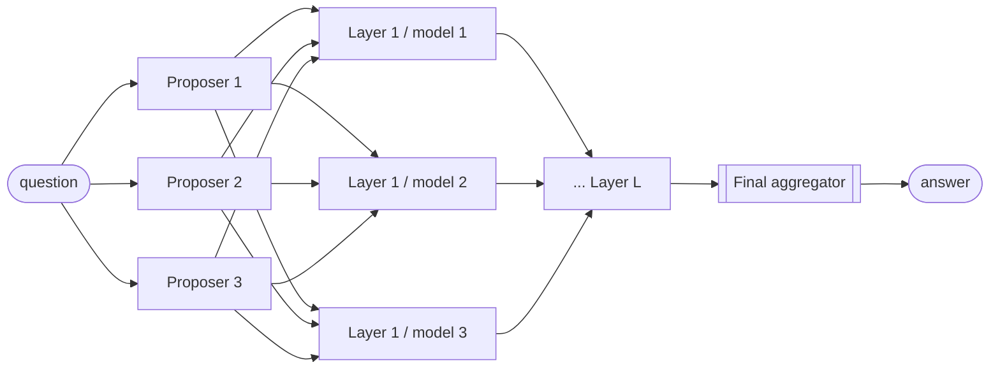
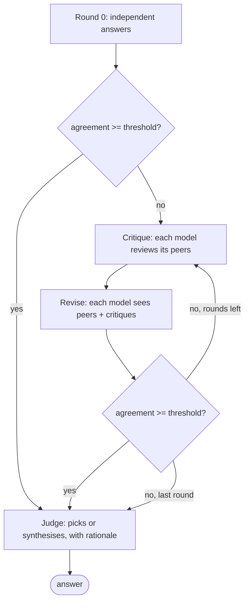
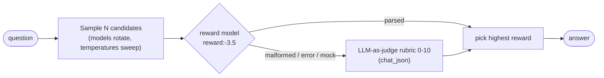
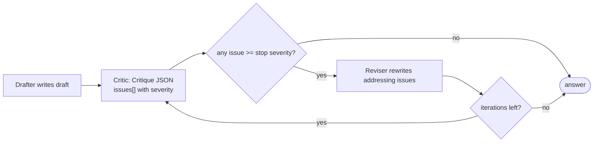

# Council: multi-model deliberation on NVIDIA NIM

Council gets a better answer than any single model by orchestrating several NIM models. It ships four
pluggable deliberation **strategies**, measures how much the models agree (embedding-based
**consensus**), records every step in a serialisable **trace**, and renders that trace as a polished,
self-contained **HTML report**. It runs fully offline in mock mode (no `NVIDIA_API_KEY` needed).

```bash
nimlab --mock council ask "Why is the sky blue?" --strategy debate --html-out trace.html
```

| Strategy | Idea | Typical cost |
|---|---|---|
| [`moa`](#mixture-of-agents-moa) | Proposers answer in parallel, layers of refinement, final synthesis | N + L·N + 1 calls |
| [`debate`](#debate) | Answer, critique peers, revise; stop on consensus; a judge decides | N + R·2N + 1 calls |
| [`best-of-n`](#best-of-n-with-a-reward-model) | Sample N candidates, score with the NVIDIA reward model, keep the best | N + N calls |
| [`critic`](#critic-loop) | Draft, structured critique, revise, until no high-severity issues | 1 + 2·iterations calls |

Plus one embedding call per consensus measurement. N = panel size, L = layers, R = rounds.

## Quick start

### CLI

```bash
nimlab council strategies                       # list strategies and their options
nimlab council ask "Is a tomato a fruit?"       # default strategy: moa, default panel
nimlab council ask "Prove sqrt(2) is irrational" -s debate --rounds 3 --threshold 0.92 \
    --models deepseek-ai/deepseek-r1,meta/llama-3.3-70b-instruct,qwen/qwq-32b \
    --json-out trace.json --html-out trace.html
nimlab council ask "Write a haiku about GPUs" -s best-of-n --n 6
nimlab council ask "Explain TCP slow start" -s critic --max-iterations 4
nimlab council render trace.json -o trace.html  # re-render a saved trace
```

`nimlab --mock council ...` (global flag) and `nimlab council ask ... --mock` both select the
offline backend; with no API key mock mode is automatic.

### Python

```python
import asyncio
from nimlab.core import NIMClient
from nimlab.council import Council

async def main() -> None:
    async with NIMClient() as client:
        council = Council(client)
        result = await council.run("Why is the sky blue?", strategy="debate", rounds=2)
        print(result.answer)
        print(result.rationale, result.agreement)
        result.save_json("trace.json")   # full trace (pydantic) as JSON
        result.save_html("trace.html")   # self-contained report

asyncio.run(main())
```

`Council()` with no client opens a default `NIMClient()`; `Council.run_sync(...)` is a blocking
wrapper. Pass `live=True` to `run` for the rich live view (see below).

## Strategies

All strategies share the same plumbing: calls go through a `RunContext` that records a trace step,
notifies observers, attributes tokens, tolerates per-model failures (a failed call is recorded in the
trace and the stage continues with the survivors) and treats an **empty response** (for example a
reasoning model that spent its whole budget in `<think>`) as a failure. Model names are hidden from
models that read other models' answers (responses are anonymised as "Response 1..N") to limit brand
bias. Reasoning models (registry role `REASONING`) automatically get `reasoning_token_multiplier`
(default 3x) times the token budget.

### Mixture-of-Agents (`moa`)



1. Every panel model answers independently, **in parallel** (`asyncio.gather`; the client's
   concurrency limit applies).
2. For each of `--layers` layers every panel model sees **all** answers of the previous layer and
   writes a refined answer (again in parallel).
3. The aggregator (`--aggregator`; default the registry's CHAT model, or the first panel model when
   `--models` is given) synthesises the last layer into the final answer.

A consensus measurement after each stage shows whether the answers are converging
(`meta["agreement_by_stage"]`). Options: `--models`, `--layers` (default 2; `0` = proposers then
aggregator), `--aggregator`.

### Debate (`debate`)



1. Independent answers (round 0).
2. Before each round the pairwise embedding cosine of the current answers is measured; if the mean
   (the *agreement*) is at or above `--threshold` (default 0.9) the debate **stops early**.
3. Otherwise each model (a) critiques its *peers'* answers, then (b) sees the peers' answers plus the
   critiques others wrote and revises its own answer. `debate_critique=False` merges this into a
   single revise step per round.
4. A **judge** (`--judge`; default the REASONING pick, or the first panel model) sees the final
   anonymised answers and a digest of the debate and returns structured JSON (`JudgeVerdict`):
   which answer is best (`selected`), the `final_answer` (the chosen answer or a synthesis), a
   `rationale` and a `confidence`. If the judge fails the next panel model is tried; if none can
   answer, the most central (medoid) answer is returned with an explanatory rationale.

A model whose revision fails keeps its previous answer. Needs at least two models. Options:
`--models`, `--rounds` (default 2), `--threshold`, `--judge`; config `early_stop`, `debate_critique`.
`meta` records `rounds_run`, `stopped_early`, `converged`, `agreement_by_round`.

### Best-of-N with a reward model (`best-of-n`)



1. `--n` candidates are sampled concurrently; models rotate through the panel and temperatures sweep
   across `temperature_range` (default 0.3 to 1.0) so no (model, temperature) pair repeats.
2. Each candidate is scored by the NVIDIA reward model (`Role.REWARD`, e.g.
   `nvidia/llama-3.1-nemotron-70b-reward`): the `[user: question, assistant: candidate]` pair is sent
   as a chat and the reply (`reward:-12.3`) is parsed by `nimlab.council.reward.parse_reward`.
3. If the reward model is unavailable, errors, replies with something unparseable, or the client is
   in **mock mode**, the candidate is graded by an LLM-as-judge rubric (`RubricScore`, 0-10) via
   `chat_json` instead. Reward logits and judge scores are on different scales, so if the two
   sources get mixed every candidate is re-graded by the judge (a warning is added to the trace).
4. The highest score wins; ties break toward the candidate most central in embedding space (the one
   the other samples agree with), then the earliest.

Each `Candidate` carries `score`, `score_source` (`reward`|`judge`), `selected` and `outlier`.
Options: `--models`, `--n` (default 4), `--reward-model`, `use_reward_model=False` to skip the reward
model, `temperature_range`.

### Critic loop (`critic`)



1. The drafter (`--models` first entry, or `drafter=`) writes a first answer.
2. The critic (second model by default, so it is an independent reviewer; `--critic`) returns a
   `Critique` via `chat_json`: a list of `Issue(severity: low|medium|high, category, description,
   suggestion)` and a summary. Severity words such as "critical" / "minor" are normalised.
3. If no issue reaches `critic_stop_severity` (default `high`) the loop stops; otherwise the reviser
   (`reviser=`, default the drafter) rewrites the draft addressing the issues and the loop repeats.
4. At most `--max-iterations` (default 3) critique/revise cycles run. If the critic or reviser is
   unreachable, the latest version is returned.

`meta` records `stop_reason` (`no_blocking_issues` | `max_iterations` | `critic_failed` |
`reviser_failed` | `no_iterations`), `iterations`, `revisions` and `issues_per_iteration`. Candidates
are the successive versions (Draft, Revision 1, ...); the consensus report compares them.

## Consensus metrics

`nimlab.council.consensus` (pure numpy) turns one vector per answer into a `ConsensusReport`:

* **pairwise cosine matrix** (`cosine_matrix`), diagonal pinned to 1;
* **agreement score**: mean off-diagonal similarity clipped to `[0, 1]` (`agreement_score`);
* **centrality**: each answer's mean similarity to the others; the highest is the **medoid**;
* **outliers**: answers whose centrality is below `mean - max(outlier_margin, outlier_z * std)`
  (defaults 0.1 and 1.0; needs three or more answers; the absolute margin stops meaningless
  differences from being flagged when everyone agrees).

Vectors come from the registry's EMBED model (`input_type="passage"`). If no embedding model is
available or the call fails, a deterministic lexical (hashed bag-of-words) fallback is used and the
report says `method: "lexical"`, so early stopping and outlier detection never silently disappear.

## Trace, JSON and HTML report

Every model call is a `TraceStep`: `type` (`propose`, `aggregate`, `draft`, `critique`, `revise`,
`judge`, `score`, `consensus`), `model`, `label`, `phase`, `prompt_summary` (and the full `prompt`
unless `record_prompts=False`), `output`, `reasoning` (`<think>` content), `status`/`error`,
`started_s`/`duration_s`/`latency_s`, and `prompt_tokens`/`completion_tokens`/`total_tokens`
(`None` when unknowable: structured-output calls are attributed from the client's usage tracker, and
left unknown if several calls to one model overlapped). Steps are numbered in launch order, so
traces are deterministic even though calls run concurrently.

```python
trace = result.trace                         # nimlab.council.Trace (pydantic v2)
trace.save("trace.json"); Trace.load("trace.json")
trace.to_json(); Trace.from_json(text)       # exact round trip
trace.steps_for("meta/llama-3.3-70b-instruct"); trace.steps_of(StepType.CRITIQUE)
trace.usage                                  # per-model calls/tokens for THIS run
```

`render_html(trace)` / `result.save_html(path)` / `nimlab council render trace.json` produce one
self-contained file (inline CSS and JS, no external assets, light and dark via
`prefers-color-scheme`): header with model colour chips and stat tiles, the final answer and
rationale, a **timeline** (one lane per model; bars link to their step), candidates with scores and
outlier flags, a **consensus heatmap** table per stage, **collapsible steps** grouped by phase
(prompt, output, reasoning, errors, metadata; expand/collapse all), and a usage table. All content
is HTML-escaped.

## Live terminal UI

`CouncilLive` is an observer that renders a `rich` tree of phases and the models working in parallel
(spinner, elapsed time, tokens, failures, per-phase agreement, a footer with totals). The CLI shows it
automatically on a terminal (`--live/--no-live` to force).

```python
from nimlab.council import Council, CouncilLive

with CouncilLive() as view:
    result = await Council(client).run("...", "moa", observers=[view])
# or simply: await Council(client).run("...", "moa", live=True)
```

Any callable taking a `CouncilEvent` works as an observer (`RunStarted`, `PhaseStarted`,
`CallStarted`, `CallFinished`, `ConsensusComputed`, `RunFinished`); observer exceptions are logged,
never raised into the run.

## Configuration

`Council(client, config=CouncilConfig(...), **overrides)` and `council.run(q, strategy, models=...,
**overrides)`; per-call overrides never mutate the council. Unset models resolve from the registry.

| Field | Default | Meaning |
|---|---|---|
| `models` | registry panel | Panel. Default: REASONING pick + CHAT pick + other families near cost tier 3 (e.g. DeepSeek-R1, Llama 3.3 70B, Nemotron Super 49B) |
| `aggregator` / `judge` | CHAT / REASONING pick (first panel model if `models` given) | MoA final aggregator / debate and rubric judge |
| `drafter` / `critic` / `reviser` | `models[0]` / `models[1]` / drafter | Critic loop roles |
| `reward_model` / `embed_model` | registry REWARD / EMBED pick | Scoring and consensus |
| `layers`, `rounds`, `n`, `max_iterations` | 2, 2, 4, 3 | Strategy shape |
| `convergence_threshold`, `early_stop` | 0.9, true | Debate early stopping |
| `critic_stop_severity` | `high` | Loop stops when no issue is at or above this |
| `debate_critique`, `use_reward_model` | true, true | Debate critique phase; try the reward model first |
| `temperature`, `aggregator_temperature`, `temperature_range` | 0.5, 0.2, (0.3, 1.0) | Sampling |
| `max_tokens`, `reasoning_token_multiplier` | 1024, 3.0 | Token budget (multiplier for `<think>` models) |
| `outlier_z`, `outlier_margin` | 1.0, 0.1 | Outlier detection |
| `system_prompt` | built-in | Overrides the proposer / draft system prompt |
| `record_prompts`, `max_parallel` | true, none | Store full prompts; extra local concurrency cap |

Model defaults follow the core registry, so `NIMLAB_MODEL_REASONING=...`, `NIMLAB_MODEL_CHAT=...`
and the `[models]` table of `nimlab.toml` apply (see [core.md](core.md)). Concurrency is bounded by
the client (`NIM_MAX_CONCURRENCY`, default 8). `NIMLAB_MOCK_LATENCY=0.2` makes the mock backend
slow enough to watch the live view.

## Writing your own strategy

```python
from typing import ClassVar
from nimlab.council import StepType, StrategyOutcome, register_strategy
from nimlab.council.context import RunContext, agent_labels

@register_strategy
class Longest:
    name: ClassVar[str] = "longest"
    description: ClassVar[str] = "Ask every model, keep the longest answer."

    async def run(self, ctx: RunContext) -> StrategyOutcome:
        msgs = [{"role": "user", "content": ctx.question}]
        answers = await ctx.gather(*(
            ctx.ask(m, msgs, label=lab, type=StepType.PROPOSE)
            for m, lab in zip(ctx.models, agent_labels(len(ctx.models)))
        ))
        ctx.require([a for a in answers if a], "answers")
        best = max((a for a in answers if a), key=lambda a: len(a.text))
        return StrategyOutcome(answer=best.text, rationale="longest wins")

# await Council(client).run("...", "longest")
```

`ctx` offers `chat` / `try_chat` / `ask` / `chat_first` (fallback list), `json` / `try_json` /
`json_first` (structured output), `consensus(phase, answers)`, `gather`, `set_phase`, `require`,
plus `ctx.question`, `ctx.config`, `ctx.models` and `ctx.roles`. Subclass `BaseStrategy` for the
CLI metadata (`aliases`, `options`, `min_models`) shown by `nimlab council strategies`.

## Errors

`CouncilError` is the base class and carries the partial `.trace` (also saved by the CLI via
`--json-out/--html-out`). `AllModelsFailedError` means every model in a stage failed,
`NotEnoughModelsError` that the strategy needs more models (debate needs two) and
`UnknownStrategyError` (also a `KeyError`) lists the registered names.

## Layout

```
src/nimlab/council/
  council.py      Council facade (config merge, role resolution, trace + usage accounting)
  context.py      RunContext: traced/tolerant model calls, consensus, observers
  strategies/     base.py (Strategy protocol + registry), moa.py, debate.py, best_of_n.py, critic.py
  reward.py       parse_reward, reward-model and rubric-judge scoring
  consensus.py    cosine matrix, agreement, outliers, lexical fallback
  records.py      Trace, TraceStep, ConsensusReport, Candidate, CouncilResult
  report.py + templates/trace.html.j2   HTML report
  live.py, terminal.py                  rich live view and result tables
  prompts.py, schemas.py, selection.py, config.py, events.py, errors.py, cli.py
```

Tests: `pytest tests/council` (offline; a scripted fake client covers convergence, reward parsing,
critic termination and consensus maths, and every strategy also runs end-to-end on the mock backend).
