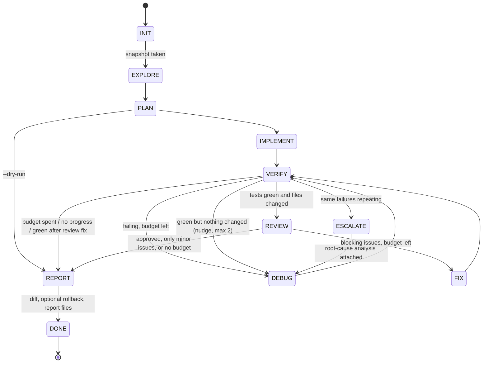

# Forge: an autonomous, test-driven coding agent on NVIDIA NIM

Give Forge a task in plain language and a workspace directory. It explores the workspace, plans with a
reasoning model, writes code **and tests** with a coder model, runs `pytest`, feeds condensed failure
reports back to the coder until the suite is green, asks a *different* model family to review the
diff, and writes a report (summary, unified diff, test results, timings, token usage). Everything the
agent can touch is confined to the workspace. It runs fully offline in mock mode (no `NVIDIA_API_KEY`
needed).

```bash
nimlab forge run "Write fizzbuzz(n) with pytest tests" --workspace ./work
nimlab forge run --task-file examples/forge/lru_cache.md -w ./lru --max-iters 8 --rollback-on-fail
nimlab forge run "Add a CLI to this project" -w ./proj --dry-run          # plan only, writes nothing
nimlab forge inspect ./work                                                # show the last report
nimlab --mock forge run "anything" -w /tmp/demo                            # offline smoke test
```

| Phase | Model role | What happens |
|---|---|---|
| Explore | none | Deterministic summary: file tree, key files (README, pyproject...), Python outline, existing tests |
| Plan | `Role.REASONING` | `chat_json` returns a `Plan(goal, steps[id, description, files], test_strategy, risks)` |
| Implement | `Role.CODER` | Tool-calling loop: `list_dir`, `read_file`, `write_file`, `apply_patch`, `run_tests`, `run_python`, `search_code` |
| Verify / Debug | `Role.CODER` | Forge runs the whole suite itself; failures go back to the coder as a condensed report |
| Escalate | `Role.REASONING` | Same failures keep repeating: root-cause analysis, then the coder retries with it |
| Review | `Role.CHAT`, other family | `chat_json` returns `Review(verdict, summary, issues[severity, file, line, ...])` over the diff |
| Fix | `Role.CODER` | Blocking review findings get one more fix round, then tests are verified again |
| Report | none | Diff vs. the start snapshot, optional rollback, `.forge/forge_report.{md,json}` |

## Contents

* [Quick start](#quick-start) · [Architecture](#architecture) · [The verify / debug loop](#the-verify--debug-loop)
* [Safety model](#safety-model) · [CLI reference](#cli-reference) · [Python API](#python-api)
* [The report](#the-report) · [Models](#models) · [Offline and mock mode](#offline-and-mock-mode)
* [Testing Forge](#testing-forge) · [Extending Forge](#extending-forge) · [Gotchas](#gotchas)

## Quick start

### CLI

```bash
# 1. Build something from scratch in an empty (or new) folder
nimlab forge run "Create a slugify(text) function with tests" -w ./slugify

# 2. Extend an existing project; roll everything back if the final tests do not pass
cp -r examples/forge/starter_workspace /tmp/wordstats
nimlab forge run -f examples/forge/extend_wordstats.md -w /tmp/wordstats --rollback-on-fail

# 3. Choose the models and the debugging budget
nimlab forge run -f examples/forge/markdown_table_parser.md -w ./mdtable \
    --planner nvidia/llama-3.3-nemotron-super-49b-v1 \
    --coder qwen/qwen2.5-coder-32b-instruct \
    --reviewer meta/llama-3.3-70b-instruct --max-iters 8

# 4. Look at the result again later
nimlab forge inspect ./mdtable --diff
```

`nimlab --mock forge ...` (global flag) and `nimlab forge run ... --mock` both select the offline
backend; with no API key mock mode is automatic. A live display shows phases and events on a
terminal; piped output gets one plain line per event.

### Python

```python
import asyncio
from nimlab.core import NIMClient
from nimlab.forge import Forge, ForgeConfig

async def main() -> None:
    async with NIMClient() as client:                       # mock mode without NVIDIA_API_KEY
        forge = Forge(client, ForgeConfig(max_iters=6, rollback_on_fail=True))
        report = await forge.run(
            "Write fizzbuzz(n) with pytest tests",
            "./work",
            on_event=lambda e: print(f"[{e.phase}] {e.kind}: {e.message}"),
        )
    print(report.status)                 # success | failed | dry_run | error
    print(report.summary)
    print(report.tests.summary_line)     # e.g. "7 passed"
    print(report.diff)                   # unified diff against the initial snapshot

asyncio.run(main())
```

`Forge.run(task, workspace, *, max_iters, planner, coder, reviewer, dry_run, rollback_on_fail,
on_event)` never raises for ordinary failures (tests that never pass, flaky model output, a revoked
key): it returns a `ForgeReport` whose `status` tells you what happened. It raises `ValueError` for an
empty task and `OSError` when the workspace path is unusable. The client's lifecycle is yours.

## Architecture



Each box is a class in `phases.py` (`InitPhase`, `ExplorePhase`, `PlanPhase`, `ImplementPhase`,
`VerifyPhase`, `DebugPhase`, `EscalatePhase`, `ReviewPhase`, `FixPhase`, `ReportPhase`). A phase's
`async run(ctx) -> State` does its work and names the next state; the `Orchestrator` owns the loop and
rejects any transition not in `TRANSITIONS` (`IllegalTransition`, a bug and not a runtime condition).
Phase crashes are recorded and the machine jumps to `REPORT`, so a report always exists; `EXPLORE`,
`ESCALATE` and `REVIEW` are optional and the run simply continues without them.

| Module | Role |
|---|---|
| `forge.py` | `Forge`: wires config, models, sandbox, tools, event bus and the orchestrator |
| `orchestrator.py`, `phases.py`, `context.py` | State machine, the phase classes, `RunContext` + `State` + transition table |
| `agent.py` | The coder's tool loop (id pairing, repeat guard, history compaction, LLM-error handling) |
| `tools.py` | `WorkspaceTools`: the seven tools, argument coercion, never raises |
| `sandbox.py` | Path confinement, allowlisted subprocesses, env scrubbing, timeouts, output caps |
| `patching.py` | `apply_patch` SEARCH/REPLACE blocks (exact, then whitespace-tolerant matching) |
| `pytest_parser.py` | pytest output to `PytestReport` + the condensed failure report |
| `snapshot.py` | In-memory workspace snapshot: unified diff (`difflib`) and exact restore |
| `progress.py` | `StallDetector`, per-phase timer, token-usage deltas |
| `events.py`, `display.py`, `cli.py` | Structured events, rich live view, `nimlab forge` |
| `models.py`, `prompts.py`, `roles.py`, `workspace.py` | Pydantic types, prompt templates, model picking, Explore |

Events (`ForgeEvent(kind, phase, message, data, ts, elapsed_s)`) are emitted for `run_start`,
`state`, `phase_start`/`phase_end`, `plan`, `llm`, `tool_call`/`tool_result`, `tests`, `stall`,
`escalate`, `review`, `rollback`, `info`/`warning`/`error`, `run_end`. Subscribe with
`Forge(on_event=cb)`, `forge.subscribe(cb)` or `run(..., on_event=cb)`; a failing subscriber is
logged and ignored.

## The verify / debug loop

After the coder's first turn Forge runs the **whole** suite itself (`pytest -q --tb=short`), so the
decision never depends on what the model claims. A model sees only a condensed report:

```text
pytest: 4 passed, 4 failed (exit code 1)
FAIL test_fizzbuzz.py::test_fizzbuzz_15
  at test_fizzbuzz.py:11 in test_fizzbuzz  >  assert fizzbuzz(15) == "FizzBuzz"
  E AssertionError: assert 'Fizz' == 'FizzBuzz'
  E - FizzBuzz
  E + Fizz
FAIL test_calc.py::test_zero
  at test_calc.py:8 in test_zero  >  assert div(1, 0) == 0
  at calc.py:5 in helper  >  return a / b
  E ZeroDivisionError: division by zero
```

Failing test ids, the first meaningful `E` lines, the outermost and innermost traceback frames with
their source line, trimmed captured output, workspace paths made relative, framework frames removed,
at most 8 failures and 3500 characters. Collection errors, setup errors, timeouts, "no tests
collected" and pytest usage errors (exit codes 3/4) each get their own wording.

* **Budget.** `--max-iters` (default 6) bounds debug rounds *and* review-fix rounds. `0` means build,
  verify once, report.
* **No-progress detection.** Every round has a signature (failing test ids + normalised messages;
  memory addresses and absolute paths are ignored). If the latest signature appears twice among the
  last four rounds (this also catches A, B, A oscillation) the run is *stalled*: the `REASONING`
  model gets the repeating failures, the relevant source files (failing frames, the tests, what they
  import, files the coder edited) and the coder's own last claim, and writes a root-cause analysis
  that is attached to the next fix prompt. After `max_escalations` analyses (default 2) that still did
  not help, the run stops with `ended_reason = "no progress"` instead of burning the remaining budget.
* **Green is not enough.** If the suite passes but no file changed at all, the coder is told the task
  is not done (at most twice); if it still changes nothing the run is `failed` ("no_changes").
* **Test integrity.** The coder is told never to weaken tests; if the number of tests drops between
  rounds the report carries a warning.
* **Review.** Only for green runs with a non-empty diff. `request_changes` with at least one
  `blocker`/`major` issue triggers one fix round (`max_review_rounds`, within the shared budget), then
  the suite is verified again. There is no second review.

## Safety model

Forge executes code a model wrote, so containment is part of the design and has its own test-suite
(`tests/forge/test_sandbox.py`, `test_tools.py`, `test_snapshot.py`).

| Concern | What Forge enforces |
|---|---|
| Path traversal | Every path is resolved with `Path.resolve()` and must end up inside the workspace root: `../x`, `a/../../x`, absolute paths outside the root, NUL bytes are rejected |
| Symlink escape | Resolution follows symlinks first, so a link (to a file, a directory, or a dangling target) that points outside is rejected for reads *and* writes; directory symlinks are never followed when walking, searching or snapshotting |
| Reserved paths | `.forge/` and `.git/` cannot be read or written by tools |
| Commands | Only `python <script.py>` and `pytest` run. No shell, no `python -c`, no `-m` other than pytest, scripts must be existing `.py` files inside the workspace, pytest options are allowlisted (`-p`, `-c`, `--rootdir`, `-o`, `--basetemp`, `--pyargs`, `--junitxml`... are refused) and pytest targets must be inside the root. Arguments are passed as an argv list, never through a shell |
| Environment | Children get a from-scratch environment: `PATH`, locale/tmp variables, `HOME` pointing into `.forge/home`, and Python hygiene flags. `NVIDIA_API_KEY`, every `*_PROXY`, `PYTHONPATH`, `PYTEST_ADDOPTS`, cloud and git tokens are dropped (an allowlist, not a deny-list) |
| Runtime | `cwd = workspace`, stdin closed, hard timeout (`--timeout`, default 90 s) that kills the whole process group (grandchildren included), CPU-time and file-size `rlimit`s on POSIX |
| Output | stdout and stderr are each capped (head + tail kept, `... N bytes truncated ...` marker); tool results are clipped again before they reach the model |
| File sizes | Reads (400 kB) and writes (500 kB) are capped; binary files are refused as text |
| Pytest isolation | If the workspace has no pytest config, Forge passes its own `-c .forge/pytest.ini`, so a `pyproject.toml` further up the tree cannot change how tests run; a workspace's own config is honoured |
| Dry run | `--dry-run` explores and plans only. The sandbox is read-only, nothing is written, not even `.forge/` (a missing workspace is not created) |
| Rollback | An in-memory snapshot is taken before anything runs (file contents, modes, symlinks, directories). `--rollback-on-fail` restores it exactly if the final suite is not green (including `error` runs), removing created files and directories. `.forge/` survives so the report can say what was attempted |
| Failure containment | Tool errors, unknown tools, malformed arguments, an unreachable LLM, a crashing phase: all end in a report, never an unhandled exception |

**What this is not.** Forge's sandbox is a guard rail, not an isolation boundary. Code that the coder
writes and runs executes as your user: it can use the network, read files your user can read, and
spawn processes. Path and command confinement apply to the agent's *tools*, not to what a Python
script does once it runs. For untrusted tasks or models, run Forge inside a container or VM (no host
mounts, no network) and treat `--rollback-on-fail` as a convenience for your own workspace.
The snapshot lives in memory (files over 2 MB or beyond 64 MB in total cannot be restored; they are
listed in a warning) and does not cover changes outside the workspace.

## CLI reference

```text
nimlab forge run [TASK] [OPTIONS]
nimlab forge inspect [DIRECTORY] [OPTIONS]
```

| `run` option | Default | Meaning |
|---|---|---|
| `TASK` | | The task. `-` reads stdin. Alternatively `--task-file/-f PATH` |
| `--workspace/-w DIR` | `.` | Working directory (created if missing; never created by `--dry-run`) |
| `--max-iters N` | `6` | Debug + review-fix rounds |
| `--planner/--coder/--reviewer MODEL` | registry roles | Override the model of a role |
| `--dry-run` | off | Explore and plan only; nothing is written |
| `--rollback-on-fail` | off | Restore the initial workspace when the final tests are not green |
| `--timeout SECONDS` | `90` | Per-command (pytest / script) timeout |
| `--mock` | off | Force the offline backend |
| `--json` | off | Print the report as JSON on stdout (no live display) |
| `--diff` | off | Print the unified diff after the report |
| `--quiet/-q` | off | No display and no report; only the exit code and files |

Exit codes: `0` success or dry run, `1` tests did not pass (`failed`), `2` usage error or fatal
`error` such as a rejected API key, `130` interrupted. In **mock mode** the exit code is `0` as long
as the pipeline completes, because placeholder model output cannot pass real tests: `nimlab --mock
forge run ...` is a smoke test of the machinery.

`inspect [DIR]` loads `DIR/.forge/forge_report.json` (or a `.forge` directory directly) and renders it;
`--json`, `--markdown/--md` and `--diff` select other views. Exit code `1` when no report exists.

Files written to `<workspace>/.forge/`:

| File | Content |
|---|---|
| `forge_report.json` | Complete `ForgeReport` (machine readable, round-trips through `ForgeReport.load`) |
| `forge_report.md` | Human report: summary, plan, tests, review, files changed, diff, timings, token usage |
| `changes.patch` | The unified diff (`patch -p1` applies it to the original workspace) |
| `pytest.ini`, `home/` | Sandbox helpers (generated pytest config, scratch `HOME`) |

Add `.forge/` to your `.gitignore`.

## Python API

```python
from nimlab.forge import (
    Forge, ForgeConfig, ForgeReport, ForgeEvent, EventBus,   # run it
    Plan, Review, Issue, Step, ModelAssignment,               # LLM-facing types
    Sandbox, SandboxLimits, PathEscapeError, CommandNotAllowedError,   # the sandbox, usable alone
    Snapshot, apply_patch_text, parse_pytest_output,          # building blocks
)
```

**Configuration** (`ForgeConfig`, all optional):

```python
ForgeConfig(
    max_iters=6, dry_run=False, rollback_on_fail=False,
    planner=None, coder=None, reviewer=None,            # None = pick from the registry
    command_timeout_s=90, max_output_bytes=48_000,
    max_tool_steps=14,                                  # tool rounds per coder turn
    coder_max_tokens=4096, planner_max_tokens=4096, reviewer_max_tokens=2048,
    stall_threshold=2, max_escalations=2, max_review_rounds=1,
)
```

**Using the sandbox on its own** (for example from another app):

```python
from nimlab.forge import Sandbox

sb = Sandbox("./work")
sb.resolve("pkg/mod.py")                      # Path inside the root, or PathEscapeError
res = await sb.run_pytest(["tests"], keyword="parser")      # ProcessResult
res = await sb.run_python("scripts/check.py", ["--fast"])   # res.ok, res.stdout, res.timed_out ...
await sb.run(["bash", "-c", "id"])            # CommandNotAllowedError
```

**Parsing pytest output** is independent of Forge: `parse_pytest_output(stdout, exit_code=1)` gives a
`PytestReport` (`passed`, `failed`, `failures[...]`, `.signature`, `.condensed()`).

**Subscribing to events** for a custom UI or logging:

```python
def on_event(e: ForgeEvent) -> None:
    if e.kind == "tests":
        print(e.message, e.data["ok"])         # "round 2: 7 passed" True

report = await Forge(client).run(task, ws, on_event=on_event)
```

## The report

`ForgeReport` fields: `task`, `workspace`, `status` (`success`, `failed`, `dry_run`, `error`),
`ended_reason`, `summary`, `mock`, `dry_run`, `models`, `plan`, `iterations`, `escalations`,
`review_rounds`, `rolled_back`, `tests` (final `PytestReport`), `test_rounds[]`, `review`,
`files_changed[]` (`path`, `status`, `additions`, `deletions`), `diff`, `root_causes[]`, `timings[]`
(per phase: seconds, runs, LLM calls, tokens in/out), `usage` (`UsageTracker.summary()` shape, only
what *this run* consumed), `warnings`, `errors`, `started_at`, `duration_s`, `events` (last 400).

`status` is `success` only if the final suite passes (at least one test ran) **and** the workspace
changed; `failed` covers exhausted budgets, no progress, an unavailable coder model and green-but-
unchanged runs; `error` covers fatal problems (authentication, a crashed non-optional phase).

## Models

| Role | Registry role | Default | Override |
|---|---|---|---|
| planner / root-cause analysis | `Role.REASONING` | `deepseek-ai/deepseek-r1` | `--planner`, `NIMLAB_MODEL_REASONING` |
| coder | `Role.CODER` | `qwen/qwen2.5-coder-32b-instruct` | `--coder`, `NIMLAB_MODEL_CODER` |
| reviewer | `Role.CHAT`, another family | `meta/llama-3.3-70b-instruct` | `--reviewer`, `NIMLAB_MODEL_CHAT` |

The default reviewer is the first `CHAT`/`FAST`/`REASONING` model whose vendor prefix differs from
the coder's, so the reviewer does not share the coder's blind spots. Reasoning models emit `<think>`
blocks; the core client strips them. Planner and RCA calls use 4096 output tokens so thinking does not
starve the answer.

## Offline and mock mode

With `NIMLAB_MOCK=1`, `--mock`, or no `NVIDIA_API_KEY`, `NIMClient` serves deterministic placeholder
responses: schema-valid JSON for `Plan` and `Review`, and (for the coder) a single call to the *first*
tool with placeholder arguments. That is why `list_dir` is the first tool: the mock's nonsense call
is harmless, the coder's tool calls all "fail" politely, and the run still ends with a full report:

```text
MOCK MODE: offline, placeholder model output. Set NVIDIA_API_KEY for real runs.
> plan      plan: 2 step(s): Goal regarding the task
> implement list_dir {"path": "Path regarding task ...", "recursive": true}
> verify    round 1: no tests collected
> debug     fix round 1/6 ...
> verify    stall: same failures 2x (NO_TESTS)
> escalate  root-cause analysis #1 by deepseek-ai/deepseek-r1
...
FAILED  2.1s  3 fix round(s)  2 escalation(s)   (exit code 0 in mock mode)
```

Mock runs exercise the sandbox, state machine, stall detection, escalation, reporting and CLI end to
end; they cannot write real code. For a scripted, realistic run see the next section.

## Testing Forge

`pytest tests/forge` (about 380 tests, roughly 80 seconds because many spawn a real `pytest`;
fully offline) covers:

* **Sandbox**: traversal, absolute paths, symlink escapes (file, directory, dangling), reserved
  dirs, env scrubbing (secrets set in the parent are absent in the child), timeouts including
  grandchildren, output caps with head and tail kept, file-size limits, the command and pytest-flag
  allowlists, parent-config isolation.
* **`apply_patch`**: exact / trailing-whitespace / indentation-insensitive matching, ambiguity, atomic
  multi-block patches, CRLF, missing trailing newline, creation, deletion, malformed blocks.
* **pytest parser**: short and long tracebacks, parametrized and class ids, collection and setup
  errors, captured output, timeouts, exit codes, signatures, plus runs against the real pytest.
* **Tools and loop**: bad arguments, unknown tools, JSON-as-string, repeat guard, history compaction.
* **Scripted end-to-end runs** with `tests/forge/forge_fakes.py::FakeClient`, a duck-typed
  `NIMClient` that plays back a script: plan JSON, then the coder writes `fizzbuzz.py` with a bug and
  `test_fizzbuzz.py`, pytest fails, the debug loop patches it, tests pass, review approves. The test
  asserts the debug loop ran once, the diff, the report files, per-phase timings and usage. Further
  scenarios: stall, escalation, `--max-iters`, rollback, review fix round, dry run, auth errors, LLM
  outages, crashing phases, a coder trying to escape the sandbox.
* **Mock mode** end to end, and the **CLI** through `CliRunner` (`--mock`, `--dry-run`, `--json`,
  `--task-file`, `inspect`).

To test your own code against Forge, write a script:

```python
from forge_fakes import FakeClient, calls, say, tc      # tests/forge/forge_fakes.py

client = FakeClient(
    chat=[calls(tc("write_file", path="m.py", content="X = 1\n"),
                tc("write_file", path="test_m.py", content="from m import X\ndef test_x():\n    assert X == 1\n")),
          say("done")],
    json=[{"goal": "g", "steps": [{"id": 1, "description": "d"}]},
          {"verdict": "approve", "summary": "ok", "issues": []}],
)
report = await Forge(client).run("task", workspace, coder="c/c", planner="p/p", reviewer="r/r")
```

A callable script (`chat=lambda call: ...`) receives a `FakeCall` (`model`, `messages`, `tools`,
`index`, `last_user`) and decides per call; `client.calls` / `client.unexpected` record everything.

## Extending Forge

* **A new tool**: add a `ToolSpec` to `TOOL_SPECS` in `tools.py` (keep `list_dir` first) and an
  `async def _t_<name>(self, ...) -> ToolOutcome` method. Go through `self.sandbox` for every path
  and process; argument coercion, error handling and clipping are inherited.
* **A new phase**: subclass `Phase`, add a `State` and its row in `TRANSITIONS`, register it in
  `default_phases()` (or pass your own dict to `Orchestrator`).
* **Another test runner**: `Sandbox.run_pytest` and `parse_pytest_output` are the only pytest-aware
  pieces.

## Gotchas

* Forge needs `pytest` in the same environment as `nimlab` (the sandbox runs `sys.executable -m
  pytest`). Tests that need other third-party packages need them installed there too.
* The default per-command timeout is 90 s; raise `--timeout` for slow suites.
* Without a pytest config of its own, a workspace is tested with Forge's generated `.forge/pytest.ini`
  (`pythonpath` = workspace root and `src/`, conftest discovery anchored at the root). If you ship your
  own `pytest.ini` / `[tool.pytest]` / `tox.ini` / `setup.cfg`, Forge uses that instead.
* Real runs bill tokens: roughly 1 planner call, 2 to 6 coder turns per round, 0 to 2 analyses and 1
  review call. `max_iters` caps the loop; `report.usage` shows what a run actually used.
* Models sometimes answer with prose instead of tool calls. The loop then ends the turn with the
  text as the "summary"; the next verification shows that nothing happened and the debug loop pushes.
* Add `.forge/` to `.gitignore`; the report directory is excluded from snapshots, diffs and
  searches but it is still a directory in your workspace.
* Snapshots are in memory and exclude `.git`, `.forge`, caches, `venv`/`.venv` and `node_modules`.
  Changes outside the workspace are neither prevented for running scripts (see Safety model) nor
  rolled back.
