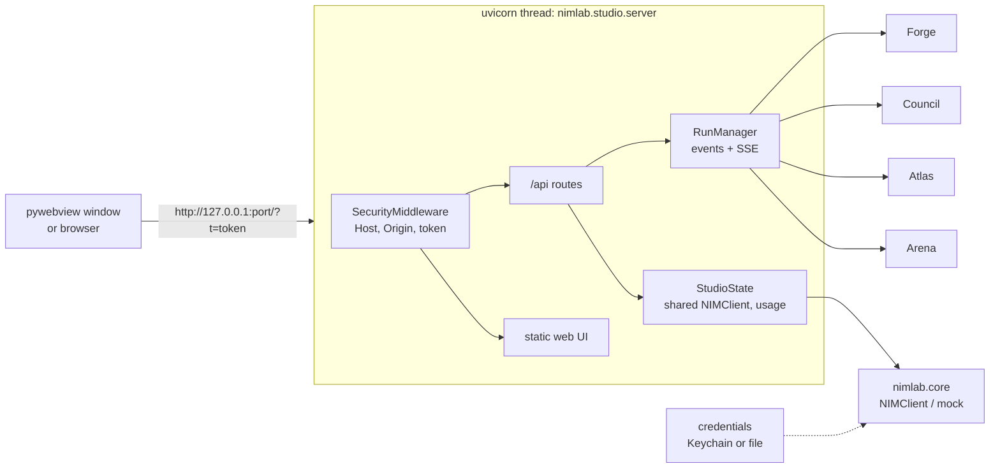

# NIM Lab Studio: the desktop app

Studio is one window for the eight apps (Council, Atlas, Forge, Arena, Prism, Sentinel, Loom, Distill). It is a small FastAPI server
that runs on `127.0.0.1`, a static web UI served from the same process, and a thin native shell
(pywebview) that shows it. Everything works without an NVIDIA key: with no key Studio runs in
**simulation mode** (see below); paste a key in the UI and the same screens use real NIM models.

```bash
pip install -e '.[desktop]'          # pywebview + keyring; both optional
nimlab studio                        # native window (or your browser if pywebview is missing)
nimlab studio --browser              # force the browser
nimlab studio --port 8123 --dev      # fixed port; web inspector + server logs
nimlab --mock studio                 # force the offline backend even if a key is stored
```

A macOS `.app` / `.dmg` is built from `packaging/macos` (see its README and [Packaging](#packaging)).

## Contents

[Architecture](#architecture) | [Simulation mode](#simulation-mode) | [API reference](#api-reference) |
[Run events](#run-events-sse) | [Security model](#security-model) | [Key storage](#key-storage) |
[Data on disk](#data-on-disk) | [Desktop shell](#desktop-shell) | [Packaging](#packaging) | [Testing](#testing)

## Architecture



| Module (`nimlab.studio.*`) | Role |
| --- | --- |
| `server` | `create_app()`: all routes, static files, error mapping |
| `security` | pure-ASGI middleware: Host check (DNS rebinding), Origin check, auth token |
| `state` | `StudioState`: one shared `NIMClient` (rebuilt when the key changes), usage tracker, runs, projects, key verification |
| `runs` | `Run` / `RunManager`: asyncio tasks with an ordered, replayable event log; JSON history |
| `forge_app`, `council_app`, `atlas_app`, `arena_app` | per-app adapters that turn each app's events into Studio events |
| `projects` | Forge projects on disk: list, tree, path-safe file reads, diff, reveal |
| `simulate`, `sim_projects` | scripted Forge client, composed Council/Atlas text, the sample projects |
| `credentials` | Keychain / `credentials.json` key store (also used by `NIMConfig`) |
| `desktop`, `cli`, `frozen` | window shell, `nimlab studio`, PyInstaller helper |
| `web/` | the static UI (HTML/CSS/JS, no build step) |

All long-running work is a **run**: `POST` an app endpoint, get a `run_id`, follow
`GET /api/runs/{id}/events` (SSE). A run keeps its whole event log in memory, so a client that connects
late (or reconnects) first receives the past events and then the live ones. One shared `NIMClient`
serves every run; saving or deleting a key replaces it (runs already in flight keep the old one).

## Simulation mode

When the client is in mock mode (no key, `NIMLAB_MOCK=1`, `--mock`), Studio does **not** show the
core mock's placeholder text. Instead:

* **Forge** is driven by `SimForgeClient`, a scripted stand-in for the NIM client. The *tools are
  real*: Forge writes real files into the project folder and runs real `pytest`. The script derives the project from the
  prompt: keyword rules pick one of about a dozen templates (FizzBuzz, todo, URL slugs, LRU cache, word
  stats, calculator, URL shortener with a stdlib HTTP API, markdown table parser, unit converter, password
  generator, text adventure, CSV stats, notes CLI). Anything else gets a generic module named after the
  prompt's words (`weather_forecast_kit.py` with `count_weather()` ...). Plan goal, step texts, README and
  review reference the prompt. Each project has a real module and pytest tests with one deliberately
  planted bug: verify finds one failing test, the coder applies a patch, tests go green, the reviewer approves. Pauses (`sim_delay`) make the UI animate.
* **Council** answers are composed per model (five voices; critique, revision and synthesis prompts
  get fitting shapes), and the judge/critic/rubric JSON replies are plausible.
* **Atlas** answers are extractive: the best-matching sentences of the retrieved passages, each with its
  `[n]` citation (retrieval, embeddings, verification and groundedness are real computations).
* **Arena** uses `nimlab.arena.simulate.SimulatedClient` (as `nimlab arena` does).

Runs record `simulated: true`, and result payloads carry `simulated`. With a key set, nothing is
simulated.

## API reference

All paths are under `/api`. JSON in, JSON out; errors are `{"detail": "..."}`. Unless noted, every
call needs the token ([Security model](#security-model)).

| Endpoint | Purpose |
| --- | --- |
| `GET /api/health` | `{ok, version}`. The only call that needs no token |
| `GET /api/status` | `{version, mode: "live"\|"mock", key: {set, source, masked}, base_url, network, apps}` |
| `POST /api/key` `{api_key}` | save the key, then verify (`list_models`, 6 s). Returns `{ok, verified, model_count, error, key}` (+ `warning`) |
| `DELETE /api/key` | remove the stored key. `{ok, key}` |
| `POST /api/key/test` | re-verify the key in use. Same shape as `POST /api/key` |
| `GET /api/models` | `[{id, roles, cost_tier, context_window, notes}]` from the registry |
| `GET /api/usage` | `{models: {id: {calls, errors, retries, tokens_in, tokens_out, total_tokens, latency_s, avg_latency_s}}, total: {...}, rows: [...], runs: {app: n}}` for this session |
| `GET /api/runs` | recent runs `[{id, app, title, status, started_at, finished_at, simulated}]`, newest first (`?limit=`) |
| `GET /api/runs/{id}` | run summary plus `result` (app-specific), `error`, `event_count` |
| `GET /api/runs/{id}/events` | SSE, see below |
| `POST /api/runs/{id}/cancel` | `{ok, id, status}`; `ok` is false if the run was already over |
| `POST /api/forge/build` `{prompt, project?, max_iters?}` | `{run_id, project}` (`project` is the folder id) |
| `GET /api/projects` | `[{id, name, path, files, updated_at, last_status}]` |
| `GET /api/projects/{id}/tree` | `{id, path, tree: [nested {name, path, type, size, children}], files: [{path, size}]}` |
| `GET /api/projects/{id}/file?path=` | `{path, size, lines, language, content}` |
| `GET /api/projects/{id}/diff` | `{project, has_report, status, summary, diff, files, started_at}` from the last Forge report |
| `POST /api/projects/{id}/reveal` | macOS: `open -R <path>`; elsewhere a no-op. `{ok, path, revealed}` |
| `POST /api/council/run` `{question, strategy, models?}` | `{run_id}`. Strategies: `moa`, `debate`, `best-of-n`, `critic` (`GET /api/council/strategies`) |
| `GET /api/atlas/collections` | `[{name, documents, chunks, embed_model, dim, created_at, files}]` |
| `POST /api/atlas/ingest` | multipart files (field `files`, optional `collection`) **or** JSON `{path, collection?}`. Returns the ingest report `{collection, files, added, updated, unchanged, errors, chunks, elapsed_s, ok}` |
| `POST /api/atlas/ask` `{question, collection?, mode, verify}` | `{run_id}`; `mode` is `simple` or `agentic` |
| `GET /api/arena/runs` | saved runs with leaderboards (newest first, at most 20) |
| `GET /api/arena/suites` | bundled suite names |
| `POST /api/arena/route` `{prompt}` | routing decision: category, chosen model, candidates with utility terms, reasons |
| `POST /api/arena/run` `{suites, models}` | `{run_id}`; `suites` is a list of bundled names or `"all"` |

`AppInfo` (in `status.apps`): `{id, name, tagline, color, glyph, status: "ready"|"needs-key"|"busy",
runs, last_run_at}`. Every app works without a key (simulation), so `status` is `ready` unless a run is
active (`busy`); `needs-key` is only reported when `StudioSettings.require_key` is on. Use `mode` and
`key.set` for a "demo mode" badge.

`status.key.source` is `keychain`, `file`, `env` or `dotenv`; `masked` looks like `nvapi-…a1b2`. The key
itself is never returned by any endpoint. `network` is `unknown` until a key check ran, then `ok` or
`blocked` (the endpoint could not be reached).

`POST /api/key` always saves a well-formed key. If the network is unreachable you get
`verified: false` and an explanatory `error`; a 401/403 gives a "rejected" error. A key from
`NVIDIA_API_KEY` / `.env` outranks the saved one, which `warning` says.

Result payloads (`run.done` data and `GET /api/runs/{id}` `result`):

* **forge**: `{project: {id, name, path, files}, status, ok, summary, ended_reason, iterations, duration_s, tests, test_rounds, files_changed, plan, review, models, usage, timings, warnings, errors, diff, simulated}`
* **council**: `{question, strategy, answer, rationale, agreement, consensus, candidates: [{label, model, text, score, score_source, selected, outlier}], models, usage, total_tokens, wall_time_s, steps, simulated}`
* **atlas**: `{question, answer, mode, collection, citations, sources, groundedness, verification, blocked, warnings, model, latency_s, usage, simulated}`
* **arena**: `{run_id, created_at, mock, judge_model, suites, elo_source, standings: [{rank, model, overall, pass_rate, elo, latency_p50_s, ...}], status, models, n_items, simulated}`

## Run events (SSE)

`GET /api/runs/{id}/events` streams `text/event-stream`. Each message is the default `message` event
whose `data` is one JSON object, and whose SSE `id` is `seq`:

```json
{"seq": 12, "ts": "2026-11-02T22:41:40.512+00:00", "run_id": "a1b2c3d4e5f6",
 "type": "file.write", "phase": "implement", "data": {"path": "todo.py", "action": "created", ...}}
```

* Past events are replayed first, then live ones. `Last-Event-ID` (or `?after=<seq>`) resumes.
* A comment line `: heartbeat` is sent every 15 s while idle.
* The stream ends after the terminal event, type **`run.done`** (`data.result`) or **`run.failed`**
  (`data.error`; a cancelled run has `data.cancelled: true`). Asking again for a finished run that you
  have fully received answers `204 No Content`, which tells `EventSource` not to reconnect.
* Every run starts with `run.start` `{app, title, simulated}`.
* The browser's `EventSource` cannot set headers, so pass the token as `?t=`.

| App | Event types (besides `run.start`, `run.done`, `run.failed`) and `data` |
| --- | --- |
| **forge** | `phase.start` `{phase, label}`; `phase.end` `{phase, seconds}`; `plan` `{goal, steps: [{id, description}]}`; `tool.call` `{tool, summary}`; `tool.result` `{tool, ok, chars}`; `file.write` `{path, action: created\|modified, bytes, lines, preview}`; `test.run` `{total}`; `test.result` `{passed, failed, errors, ok, iteration, summary, names, failing, results: [{name, status}]}`; `review` `{verdict, issues, blocking, message}`; `log` `{level, message, kind}`; `usage` `{model, tokens_in, tokens_out, latency_s, totals}`. Phases: `init explore plan implement verify debug escalate review fix report` |
| **council** | `stage.start` `{stage, strategy}` / `stage.end` `{stage, seconds}`; `model.start` `{step, model, label, stage, kind}` / `model.end` `{step, model, label, ok, duration_s, tokens, preview, error}`; `consensus` `{stage, agreement, outliers}` |
| **atlas** | `trace` `{kind, message, data}` (retrieval, verification steps); `sources` `{sources: [...]}`; `token` `{text}`; `log` (re-embedding notice) |
| **arena** | `plan` `{models, suites, items, total_calls}`; `item` `{done, total, model, suite, item, score, passed, latency_s, error}` |

`test.result.names` is the list of test ids found in the project's test files; `failing` the failing ids
reported by pytest (Forge's `tests` event carries them as `failing`, a one-line addition made for
Studio). `results` combines the two.

## Security model

Studio is a local app that can read your project folders and spend your API credits, so the server is
locked down even though it only listens on loopback.

* **Loopback only.** Bound to `127.0.0.1` (a socket created before uvicorn starts), on a free port
  unless `--port` is given.
* **Auth token.** A fresh 256-bit random token is generated at startup and passed to the window in the
  URL (`/?t=...`). The UI keeps it in `sessionStorage` and sends it as `X-Studio-Token` on every request
  (`?t=` for `EventSource`). Every `/api/*` call except `/api/health` is refused with 401 without it
  (constant-time comparison). Other local programs and other websites cannot know it.
* **DNS rebinding.** The `Host` header must be `127.0.0.1`, `localhost` or `[::1]` (any port), otherwise 403.
* **Cross-site requests.** A request with an `Origin` header must come from a loopback origin, otherwise
  403. No CORS headers are ever sent, so browsers will not hand responses to other origins.
* **Headers.** `X-Content-Type-Options: nosniff`, `Referrer-Policy: no-referrer` (the token never
  leaks through `Referer`), `X-Frame-Options: DENY`, `Cross-Origin-Resource-Policy: same-origin`.
* **File access.** Project ids are slugs resolved under the projects folder (symlinked folders are
  ignored); `file?path=` rejects absolute paths, `..`, NUL bytes, drive letters and symlink escapes,
  refuses Studio's own `.forge` data, binary and non-UTF-8 files, and files over 512 KB.
  Forge itself runs inside its own sandbox (path confinement, allow-listed commands).
* **Atlas ingest by path** reads any folder you name; it is token-protected like everything else.
* **Secrets.** The API key never appears in responses, events, history or logs (only the masked form).
* **Tests** can run with `StudioSettings(token=None)` (and `check_host=False` if needed).

## Key storage

`nimlab.studio.credentials` (also used by `NIMConfig.from_env()`):

| Function | |
| --- | --- |
| `save_api_key(key)` | Keychain first, file as the fallback. Validates loosely: must not be empty or contain whitespace; a key that does not start with `nvapi-` or has an unusual length is saved with a warning |
| `load_api_key()` | stored key (Keychain, then file) or `None`; never reads the environment |
| `delete_api_key()` | removes it from every backend |
| `key_source()` | where the key in use comes from: `env`, `dotenv`, `keychain`, `file` or `None` |

* **Keychain**: through the optional `keyring` package (service `nimlab`, account `nvidia_api_key`),
  used only when a real backend exists (not the "fail" backend) and it works.
* **File**: `~/.config/nimlab/credentials.json` (`$NIMLAB_CONFIG_DIR` overrides the folder), written to a
  temp file with mode 0600 in a 0700 folder and renamed into place.
* `NIMLAB_DISABLE_KEYRING=1` skips the keyring entirely.
* Key precedence in `NIMConfig.from_env()`: **explicit argument, then `NVIDIA_API_KEY`, then `./.env`, then the
  stored credential.** A broken keyring never breaks the core: it is treated as "no stored key".
* The test suite points `NIMLAB_CONFIG_DIR` at a temp dir and disables the keyring for every test.

## Data on disk

| Path | Content | Override |
| --- | --- | --- |
| `~/NIMLab/` | Studio home | `$NIMLAB_STUDIO_HOME` |
| `~/NIMLab/Projects/<slug>/` | Forge projects (`.forge/` holds Forge's report and Studio's metadata) | `$NIMLAB_PROJECTS_DIR` |
| `~/NIMLab/atlas.db` | Atlas knowledge base | `$NIMLAB_ATLAS_DB` |
| `~/NIMLab/arena/runs/*.json` | Arena runs (also used by the router) | |
| `~/NIMLab/studio_history.json` | per-app run counts and the last 100 runs (results kept for the latest 20) | |

Runs live in memory while Studio is open. Reopening Studio restores the history; events are not
replayed, only a final `run.done` / `run.failed` with the stored result. A run that was active when
Studio quit is shown as failed ("interrupted"). If an Atlas collection was embedded by a different
backend (mock, then a real key), Studio re-embeds it once and retries.

## Desktop shell

`nimlab studio [--browser] [--port 0] [--dev]` starts uvicorn on a free `127.0.0.1` port in a
background thread, waits for `/api/health`, then opens the UI.

* **pywebview installed:** a native window "NIM Lab Studio", 1280x820, minimum 960x640, background `#0B0A12`
  (no white flash). On macOS the window is frameless with the system traffic lights kept and the app
  forced to dark appearance, so the web UI draws its own title bar (`pywebview-drag-region`, 78 px left
  padding). Options the installed pywebview does not support are dropped instead of failing.
* **Otherwise / `--browser`:** the default browser, with the tokened URL printed in the terminal.
* **JS bridge** (`window.pywebview.api`): `pick_folder()` opens the native folder dialog and returns the
  path (or `null`); `open_path(path)` opens a file or folder with the OS default app.
* Closing the window (or Ctrl+C in browser mode) stops the server and cancels running jobs.

## Packaging

`packaging/macos/` builds the `.app` with PyInstaller (windowed, bundle id `dev.nimlab.studio`,
`LSMinimumSystemVersion 12.0`, high-resolution capable, dark appearance), draws the icon, ad-hoc signs,
and can wrap a `.dmg`. See `packaging/macos/README.md` for the exact steps and Gatekeeper/notarization
notes. A frozen app re-invokes itself as the "python" for Forge's `pytest` runs (`nimlab.studio.frozen`).
It has not been run on macOS; the spec and the frozen binary were exercised on Linux.

## Testing

```bash
python -m pytest tests/studio -q
```

The suite needs no network, key, display or pywebview: it covers the credential store and key
precedence, every endpoint through `TestClient` (key verification with `respx` for reachable and
blocked networks), SSE replay/resume/live/heartbeat/cancel, a simulated Forge build (event order,
real files, one failing test then green), a scripted-client Forge build through the real-client path,
project browsing and path traversal, Council/Atlas/Arena runs in mock mode, token/Host/Origin checks,
the desktop module without pywebview, a real uvicorn start/stop, and the CLI.
